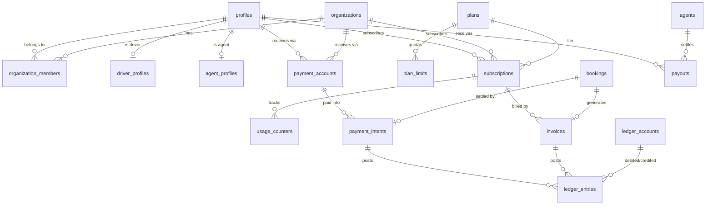

# Maak (معك) — Trip Management SaaS Platform

**Product & Technical Specification — v1.1**
Status: Draft for approval · Owner: Product/Engineering · Last updated: 2026-10-28

> **v1.1 changes** — added: payments (cash, e-wallet, agent cash-in, bank deposit), payment-account registry
> for platform **and** verified users, a finance module for individuals/companies, and Basic/Pro/Business
> subscription plans with enforced quotas. Localisation upgraded to a fully bilingual product
> (Arabic RTL first-class + English LTR first-class, not an afterthought).
> See `IMPLEMENTATION_PLAN.md` for the revised 13-phase delivery.

---

## 0. TL;DR

Maak is a multi-tenant SaaS for intercity and inter-governorate trip operation in Yemen.
Individuals and companies register, get verified, subscribe to a plan, register vehicles and drivers,
publish trips, sell seats, and collect money through cash / e-wallets / agents / bank deposits.
Passengers search a public marketplace, book with ID details, pay, and follow the trip live.
Platform staff verify accounts, vehicles, trips and passengers, supervise governorates and custom
regions — including by scanning a trip QR and printing an A4 manifest — and finance staff reconcile
every payment against a double-entry ledger.

**Architecture in one line:** Next.js (web) + Expo (iOS/Android) sharing one `@maak/core` package,
against a **Supabase** backend where **all business rules live exactly once — in Postgres**
(RLS + RPC functions). No separate API server, no duplicated logic per client.

**Delivery:** 13 phases (0–12), each independently shippable.

---

## 1. Goals & Success Criteria

| # | Goal | Success measure (v1) |
|---|------|----------------------|
| G1 | Operators go from signup → verified → first published trip fast | ≤ 24h median verification; ≤ 10 min to publish after approval |
| G2 | Passengers find a suitable trip without asking anyone | ≥ 60% of sessions use ≥ 1 filter; search p95 < 300 ms |
| G3 | Trust: nobody unverified or unsubscribed can sell | 0 publicly visible trips from unverified owners (RLS-tested) |
| G4 | Money is traceable to the last riyal | 100% of payments land in the ledger; ledger balances to zero every day |
| G5 | Operational visibility for authorities/supervisors | QR scan → manifest < 3 taps; A4 PDF < 2 s |
| G6 | Arabic and English are equal citizens | Every screen ships both locales; no layout break in either direction (visual suite) |
| G7 | Cheap to maintain | 1 implementation per rule; a new client or locale = 0 rule changes |

### Non-goals for v1 (explicitly deferred)
- **Automated card/PSP acquiring and webhooks** (adapter interface is built; no live gateway in v1 —
  Yemeni coverage is thin and reconciliation is manual anyway). Card is a future method, not a v1 flow.
- Escrow-style holding of passenger funds with instant automated payouts (v1 uses a recorded
  receivable/payable ledger with manual/agent settlement).
- Multi-currency settlement, VAT/tax filing integrations, payroll.
- Recurring trip series / route templates, seat-map selection, ratings & reviews, chat.
- WhatsApp Business API (deep links only), full call-center console, non-Yemen geography.

---

## 2. Personas & Roles

| Role key | Who | Primary surface |
|---|---|---|
| `guest` | Anonymous visitor | Public site (search, trip detail) |
| `individual` | Solo owner-driver / small operator | Operator console |
| `org_owner` | Company owner | Company console |
| `org_manager` | Company staff managing trips/vehicles/drivers | Company console |
| `org_accountant` | Company finance user (invoices, statements, expenses) | Finance console (read + reconcile) |
| `driver` | Physically drives; usually an employee | Driver mobile app |
| `passenger` | Anyone who booked | Passenger app + live tracking |
| `agent` | Cash-in agent (shop/branch) collecting and depositing money | Agent console |
| `geo_supervisor` | Staff with region/sub-region scope | Supervisor console (QR, verify) |
| `platform_staff` | Ops staff (verification) | Ops console |
| `finance_officer` | Platform finance (payment confirmation, refunds, payouts, reconciliation) | Finance back-office |
| `platform_admin` | Full control: geography, roles, plans, settings | Admin console |

A person can hold several roles at once (owner + driver + passenger). **Roles are never a scalar on the
user row.** Effective permissions derive from `profiles.verification_status`, `organization_members.role`,
`user_roles`, `driver_profiles`, `agent_profiles` and `subscriptions`, evaluated by SQL helpers only.

---

## 3. Glossary

- **Actor** — identity performing an action: an individual profile **or** an organization.
- **Operator** — a verified actor that can own vehicles/trips.
- **Place** — any addressable point (governorate, district, city, village, landmark, station, airport, border, market, gathering point).
- **Region / Sub-region** — platform-admin-defined grouping of governorates and/or districts (not an official Yemeni level), used for supervisor scoping and grouping.
- **Manifest** — the one-page A4 PDF with vehicle, driver and passenger details for a trip.
- **Payment account** — a destination/source of money: bank account (IBAN/account no.), e-wallet number, or cash agent. Owned by the platform or by a verified user/org.
- **Agent** — an entity (shop/branch) that collects cash from passengers and settles with the platform; has a float balance and a commission.
- **Payment intent** — a claim "someone will pay X for Y", with method, reference, optional proof, and a confirmation step.
- **Ledger** — append-only double-entry journal; the single source of financial truth.
- **Plan** — a subscription tier (`basic`, `pro`, `business`) with priced quotas.
- **Quota** — a numeric limit enforced at the DB layer (vehicles, trips/month, staff, drivers).

---

## 4. Domain Model

### 4.1 ERD (core + money)



*(Fleet and trip tables are unchanged from v1.0 — see §4.2 and §6.3–6.9.)*

### 4.2 Tables

Schemas: `public` (domain), `app` (private helpers), `audit` (append-only history).

**Identity & trust**
| Table | Key columns |
|---|---|
| `profiles` | `id (auth.users)`, `full_name`, `phone`, `phone_verified_at`, `nationality`, `dob`, `avatar_path`, `verification_status`, `preferred_language (ar,en)`, `preferred_numerals (western,arabic_indic)`, `timezone`, `created_at`, `deleted_at` |
| `organizations` | `id`, `legal_name`, `display_name`, `slug`, `tax_id`, `commercial_reg_no`, `logo_path`, `city_place_id`, `contact_phone`, `contact_email`, `verification_status`, `created_by` |
| `organization_members` | `org_id`, `user_id`, `role (owner,manager,dispatcher,accountant)`, `status (invited,active,removed)`, `invited_by`, `accepted_at` |
| `user_roles` | `user_id`, `role (platform_admin,platform_staff,finance_officer,geo_supervisor)`, `granted_by`, `revoked_at` |
| `verification_requests` | `subject_type (profile,organization,vehicle,driver,agent)`, `subject_id`, `status`, `submitted_by`, `reviewed_by`, `decision_reason`, `decided_at`, `documents jsonb` |
| `audit_log` | `id`, `actor_id`, `action`, `entity_type`, `entity_id`, `before jsonb`, `after jsonb`, `ip`, `created_at` |

**Geography** (unchanged from v1.0)
`regions` (self-referencing, `level: region|sub_region`), `governorates`, `districts` (+geometry),
`places` (`type`, `name_ar/en`, `aliases[]`, `point geography`, `is_popular`, `is_verified`),
`region_governorates`, `region_districts`, `geo_assignments` (`scope_type`, `scope_id`, `can_view_passengers`).

**Fleet** (unchanged from v1.0)
`vehicles` (~60 attribute columns, `owner_profile_id` XOR `owner_org_id`, `current_odometer_km`),
`vehicle_photos`, `driver_profiles`, `vehicle_driver_assignments`, `odometer_readings`,
`fuel_logs`, `maintenance_records`, `maintenance_schedules`.

**Trips** (unchanged from v1.0, plus payment policy)
`trips` — as before **plus** `payment_policy (cash_on_boarding | prepay_optional | prepay_required)`,
`deposit_percent`, `accepts_cash`, `accepts_e_wallet`, `accepts_bank_deposit`, `accepts_agent`.
`trip_stops`, `bookings` (+ `payment_status`, `amount_paid_minor`, `amount_due_minor`),
`passenger_documents`, `trip_verifications`, `trip_location_pings`, `trip_progress`, `trip_events`.

**Payments**
| Table | Key columns |
|---|---|
| `payment_accounts` | `id`, `owner_type (platform,profile,organization,agent)`, `owner_id`, `method (bank,e_wallet,cash)`, `provider` (`alkuraimi_jaib,cash_one,mfloos,yempay,al_kuraimi_bank,tadhamon,other_cash`), `account_ref` (IBAN / wallet number / branch code), `holder_name`, `branch`, `currency`, `instructions_ar/en`, `is_default`, `status (active,disabled,pending_verification)`, `verified_by`, `verified_at`, `created_by` |
| `payment_intents` | `id`, `code` (human ref `PAY-2026-000456`), `purpose (booking,booking_balance,subscription,payout,top_up,adjustment)`, `booking_id`, `invoice_id`, `payer_user_id`, `payee_owner_type/owner_id`, `amount_minor`, `currency`, `method (cash,e_wallet,bank_deposit,agent)`, `payment_account_id`, `reference_no` (customer-entered txn ref), `proof_path` (receipt photo), `status (created,awaiting_proof,submitted,confirmed,rejected,refunded,expired,cancelled)`, `submitted_at`, `confirmed_by`, `confirmed_at`, `rejection_reason`, `agent_id`, `idempotency_key`, `metadata jsonb` |
| `refunds` | `id`, `payment_intent_id`, `booking_id`, `amount_minor`, `reason`, `status (requested,approved,paid,rejected)`, `method`, `processed_by`, `processed_at`, `payout_id` |
| `agents` | `id`, `code`, `name`, `owner_profile_id`, `city_place_id`, `branch_label`, `commission_kind (fixed,percent)`, `commission_value`, `float_balance_minor`, `credit_limit_minor`, `status (active,suspended)`, `verified_by`, `verified_at` |
| `agent_transactions` | `id`, `agent_id`, `payment_intent_id`, `kind (cash_in,cash_out,settlement,adjustment)`, `amount_minor`, `balance_after_minor`, `created_by`, `note` |
| `payouts` | `id`, `payee_owner_type/owner_id`, `amount_minor`, `currency`, `status (requested,approved,processing,paid,rejected)`, `method`, `payment_account_id`, `period_start`, `period_end`, `reference_no`, `proof_path`, `approved_by`, `paid_at`, `note` |
| `payout_items` | `payout_id`, `booking_id`, `amount_minor` |

**Finance (double-entry)**
| Table | Key columns |
|---|---|
| `ledger_accounts` | `id`, `code`, `name_ar/en`, `type (asset,liability,revenue,expense,equity)`, `owner_scope (platform,profile,organization,agent)`, `owner_id`, `currency`, `is_system` |
| `journal_entries` | `id`, `entry_no`, `description`, `posting_date`, `source_type (payment,refund,payout,invoice,commission,adjustment,subscription)`, `source_id`, `created_by`, `created_at`, `reverses_entry_id` |
| `ledger_entries` | `journal_entry_id`, `ledger_account_id`, `direction (debit,credit)`, `amount_minor`, `currency`, `owner_type`, `owner_id`, `memo` — **`sum(debit) = sum(credit)` enforced per journal entry** |
| `invoices` | `id`, `invoice_no`, `kind (booking,subscription)`, `booking_id`, `subscription_id`, `issued_to_type/id`, `issued_by_owner_type/id`, `currency`, `subtotal_minor`, `discount_minor`, `commission_minor`, `tax_minor`, `total_minor`, `status (draft,open,paid,void,refunded)`, `due_at`, `snapshot jsonb` (frozen line items + names, PII-minimal), `pdf_path` |
| `expenses` | `id`, `owner_type/id`, `category (fuel,maintenance,salary,rent,commission,fees,other)`, `vehicle_id`, `trip_id`, `amount_minor`, `currency`, `spent_at`, `vendor`, `payment_intent_id`, `receipt_path`, `note` |
| `commission_rules` | `id`, `scope (global,owner)`, `owner_id`, `kind (percent,fixed)`, `value`, `min_minor`, `max_minor`, `effective_from`, `effective_to` |
| `statements` | `id`, `owner_type/id`, `period_start`, `period_end`, `opening_balance_minor`, `closing_balance_minor`, `gross_minor`, `commission_minor`, `payouts_minor`, `status (draft,issued)`, `pdf_path` |

**Plans & subscriptions**
| Table | Key columns |
|---|---|
| `plans` | `code (basic,pro,business)`, `name_ar/en`, `description_ar/en`, `price_minor`, `currency`, `interval (month,year)`, `trial_days`, `features jsonb`, `is_active`, `is_public`, `sort_order`, `grace_days` |
| `plan_limits` | `plan_code`, `metric (vehicles,trips_per_month,staff,drivers,active_trips,featured_listings,finance_exports)`, `limit_value` (`NULL` = unlimited), `soft_limit` (warn vs block) |
| `subscriptions` | `id`, `owner_type (profile,organization)`, `owner_id`, `plan_code`, `status (trialing,active,past_due,grace,cancelled,expired)`, `period_start`, `period_end`, `cancel_at_period_end`, `trial_ends_at`, `started_at`, `ended_at`, `created_by` |
| `usage_counters` | `subscription_id`, `period_start`, `metric`, `value`, `updated_at` (upserted on each metered action) |
| `subscription_events` | `subscription_id`, `kind (created,upgraded,downgraded,renewed,cancelled,expired,past_due,limit_reached)`, `payload jsonb`, `at`, `actor_id` |
| `quota_violations` | `subscription_id`, `metric`, `attempted_at`, `actor_id`, `context jsonb` (for upgrade nudges + abuse detection) |

**Money representation:** `*_minor bigint` + `currency char(3)` (YER exponent 0). Never floats.
Rounding documented in `app.money_round()` (half-up), unit-tested.

---

## 5. Permission Model

### 5.1 Trust & entitlement gates

| Gate | Blocks | Enforced by |
|---|---|---|
| Actor verified | add vehicle, create trip, assign driver, accept/cancel booking, add payout account | RLS + `app.is_verified_actor()` |
| Vehicle verified + active | attach to publishable trip | trigger |
| Driver verified | attach to trip | trigger |
| Trip verified | driver "Start trip" | `start_trip()` |
| Active subscription with quota | create vehicle / trip / staff / driver beyond plan | `app.assert_quota()` in RPCs |
| Payment confirmed (when `payment_policy = prepay_required`) | seat stays `pending` → not confirmed | `accept_booking()` / payment hook |

Entitlement resolution: `app.owner_effective_plan(owner_type, owner_id)` returns the plan + limits,
falling back to `basic` defaults if no subscription exists. **A missing subscription never means
"unlimited"** — it means basic limits (safe default).

### 5.2 Capability matrix — core

| Capability | Guest | Passenger | Verified individual | Verified company (owner/manager) | Driver | Geo supervisor | Platform staff | Platform admin |
|---|---|---|---|---|---|---|---|---|
| Browse public trips & filters | ✅ | ✅ | ✅ | ✅ | ✅ | ✅ | ✅ | ✅ |
| Book a seat | ❌ | ✅ | ✅ | ✅ | ✅ | ✅ | ✅ | ✅ |
| Own bookings / history | ❌ | ✅ | ✅ | ✅ | ✅ | ✅ | ✅ | ✅ |
| Live progress | ❌ | booked only | booked only | own trips | driving only | in scope | all | all |
| Register vehicle / driver | ❌ | ❌ | ✅ (within quota) | ✅ (within quota) | ❌ | ❌ | ❌ | ✅ |
| Create / edit trip | ❌ | ❌ | ✅ own (within quota) | ✅ org (within quota) | ❌ | ❌ | ❌ | ✅ |
| Assign vehicle/driver | ❌ | ❌ | ✅ own | ✅ org | ❌ | ❌ | ❌ | ✅ |
| Accept / reject / cancel booking | ❌ | ❌ | ✅ own | ✅ org | ❌ | ❌ | ✅ | ✅ |
| Verify accounts/vehicles/drivers | ❌ | ❌ | ❌ | ❌ | ❌ | ❌ | ✅ | ✅ |
| Verify trips / passengers (bulk) | ❌ | ❌ | ❌ | ❌ | ❌ | ✅ in scope | ✅ | ✅ |
| Search historical trips | ❌ | own only | own only | own only | own only | in scope | ✅ all | ✅ all |
| Manage geography & regions | ❌ | ❌ | ❌ | ❌ | ❌ | view | view | ✅ |
| Assign geo supervisors | ❌ | ❌ | ❌ | ❌ | ❌ | ❌ | ❌ | ✅ |
| Print A4 manifest | ❌ | ❌ | own trips | own trips | ❌ | in scope | ✅ | ✅ |

### 5.3 Capability matrix — money

| Capability | Passenger | Verified individual | Verified company (owner) | `org_accountant` | Agent | Finance officer | Admin |
|---|---|---|---|---|---|---|---|
| Pay for a booking (cash/e-wallet/agent/bank) | ✅ | ✅ | ✅ | ✅ | ✅ (on behalf) | ✅ | ✅ |
| Upload payment proof (receipt) | ✅ | ✅ | ✅ | ✅ | ✅ | ✅ | ✅ |
| Confirm/reject a payment | ❌ | ✅ own trips' bookings | ✅ org trips' bookings | ✅ org | ✅ own cash-ins only | ✅ all | ✅ all |
| Add own payout/bank account | ❌ | ✅ | ✅ | ❌ | ✅ | ❌ | ✅ |
| Add/edit **platform** payment accounts | ❌ | ❌ | ❌ | ❌ | ❌ | ✅ | ✅ |
| Finance dashboard (revenue, expenses, statements) | ❌ | ✅ own | ✅ org | ✅ org | own float | ✅ all | ✅ all |
| Issue/void invoice | ❌ | ✅ own bookings | ✅ org | ✅ org | ✅ own | ✅ all | ✅ all |
| Request payout | ❌ | ✅ | ✅ | ❌ | ✅ | ❌ | ✅ |
| Approve payout / mark paid | ❌ | ❌ | ❌ | ❌ | ❌ | ✅ | ✅ |
| Process refund | ❌ | request only | request only | request only | ❌ | ✅ | ✅ |
| Manage commission rules | ❌ | ❌ | ❌ | ❌ | ❌ | ❌ | ✅ |
| Manage plans & limits | ❌ | ❌ | ❌ | ❌ | ❌ | ❌ | ✅ |
| Subscribe / upgrade / cancel plan | ✅ personal | ✅ | ✅ | ❌ | ✅ | ❌ | ✅ |
| View ledger entries | ❌ | own | own | own | own | ✅ all | ✅ all |
| Post manual journal adjustment | ❌ | ❌ | ❌ | ❌ | ❌ | ✅ | ✅ |

### 5.4 Enforcement layers (defense in depth)

1. **DB constraints** — invariants that must never break (seats ≥ 0, balanced journal entries, monotonic ODO).
2. **RLS policies** — row visibility on every table, `FORCE ROW LEVEL SECURITY`.
3. **RPC functions** (`SECURITY DEFINER`, pinned `search_path`) — every state transition; UI never writes
   tables directly (trivial own-profile fields excepted).
4. **Client guards** — UX only. Never the security boundary.

---

## 6. Functional Specification

### 6.1 Accounts, onboarding & verification

**Individual:** sign up by phone OTP (primary) or email+password → profile (name, phone, avatar, country,
preferred language/numerals) → submit verification (ID type `national_id|passport|residence`, number,
place of birth, ID photos, optional selfie) → `unverified → pending → verified | rejected(reason)`.
Rejection is editable and resubmittable.

**Company:** created by a verified individual (becomes `org_owner`) → legal name, display name, slug,
commercial registration no., tax ID, logo, address place, contacts → verification with CR document +
owner ID → team invites (`manager`, `dispatcher`, `accountant`) by phone/email.

**Platform/geo/finance roles:** granted only by `platform_admin`; audited; `geo_supervisor` requires ≥ 1
`geo_assignments` row.

**Rules:** one phone = one auth user; a user may belong to many organizations; context switching is UI-only
(server re-evaluates); deletion = soft delete + anonymisation after 30 days, retaining financial/audit
records; every verification decision is audited and notified.

**Localisation at account level:** `preferred_language` and `preferred_numerals` are stored on the profile
and applied everywhere (web, mobile, PDFs, emails, notifications). Switching locale never changes URLs
semantics — see §16.

### 6.2 Geography & places

Unchanged from v1.0: `regions` (self-referencing, admin-defined) → governorates and/or districts;
seeded 22 governorates, ~333 districts, ~200 curated places (airports, ports, borders, landmarks,
hospitals, universities, markets); admin CRUD + idempotent CSV/GeoJSON import with dry-run diff;
shared **`<PlacePicker>`** with AR/EN trigram autocomplete, aliases, cascade, popular places,
"use my location", custom gathering points (pending staff verification).

**Supervisor scoping:** `geo_assignments` at region/sub-region/governorate/district level, with
`can_view_passengers`. A trip is in scope when pickup, gathering point, destination **or any stop**
intersects the scope (`app.trip_in_scope()`, backed by `trip_scope_index`).

### 6.3 Fleet: vehicles & drivers

Full attribute set unchanged (identity, mechanical, capacity, comfort, safety/compliance, accessibility,
appearance, media, operational — ~60 columns; see v1.0 field list retained in migration `00030_vehicles`).

Additions for v1.1:
- Vehicle creation is gated by **plan quota** (`vehicles`) and actor verification.
- Soft-downgrade behaviour: existing vehicles stay, new ones blocked, with an upgrade prompt.
- Vehicle count surfaced in the plan usage widget.

Drivers unchanged: linked auth user, licence data, verification, `vehicle_driver_assignments`,
override with reason (audited). Driver count is quota-gated (`drivers`).

### 6.4 Trip creation & lifecycle

Unchanged lifecycle and 2-hour edit lock (BR-06), with these v1.1 additions:

- **Payment policy on the trip:** `cash_on_boarding` (default), `prepay_optional`, `prepay_required`.
  `prepay_required` means a booking is not confirmed until a payment is `confirmed`.
- Accepted payment methods per trip: `accepts_cash`, `accepts_e_wallet`, `accepts_bank_deposit`,
  `accepts_agent` (booleans, default all true except bank).
- Optional `deposit_percent` (e.g. 30% to hold the seat) — enforced by `book_seats()`.
- **Quota gate:** creating a trip consumes `trips_per_month`; the RPC returns `QUOTA_EXCEEDED` with
  `{ plan, metric, limit, used, upgrade_url }` so the client can show an upgrade dialog, not a dead end.

### 6.5 Public discovery & search

Unchanged: cascading facets, keyset pagination, active-only visibility (BR-07/08), staff historical search,
saved-filter URL state, JSON-LD SEO.

v1.1 additions:
- **Bilingual search**: `search_public_trips(locale, …)` returns names in the requested locale with fallback;
  Arabic and English both indexed (normalised Arabic — alef/hamza/teh-marbuta folding, diacritics stripped).
- **Plan-driven merchandising:** `featured_listings` quota lets Pro/Business operators pin trips to the top
  of results (clearly labelled, never disguised as organic).
- Operator card shows plan badge only where it is meaningful (e.g. "شركة موثّقة").

### 6.6 Booking & passenger details

Unchanged flows (stop selection, passenger identity form, ID photo, WhatsApp private share, holds,
operator accept/reject, cancellation cutoffs) with payments wired in:

- Booking lifecycle extends to `pending → accepted → confirmed` where **`confirmed` requires
  payment when `prepay_required`**; otherwise `accepted` is terminal-good and money is collected on boarding.
- `bookings.payment_status (unpaid, deposit_paid, paid, refunded, partially_refunded)` is derived from
  confirmed payment intents — never set by hand.
- On accept with `prepay_required`: passenger gets a "complete payment" prompt with the accepted methods,
  the platform's payment accounts (or the operator's own accounts if the operator collects directly),
  reference instructions, and a proof upload.
- Cancellation refund rules: refund eligibility is a pure function
  `app.compute_refund(booking_id, cancelled_at)` → `{ amount_minor, reason, policy_snapshot }`,
  honouring the trip's cancellation policy and the 2-hour cutoff. Finance officer executes; v1 records
  the refund and (if paid) creates a payout/reversal — no automatic PSP refund.

### 6.7 Trip execution, live location & progress

Unchanged (verified-only start, ODO at start/end, 10-minute pings, progress text, staleness rules,
booked-only visibility).

v1.1 additions:
- **Cash collection at boarding** (when policy is cash/on-boarding): the driver sees "collect 5,000 YER"
  per passenger and can mark `cash_collected` (offline-tolerant, queued) — creating a payment intent with
  method `cash` pending confirmation by the operator/finance. This makes cash trips auditable end-to-end.
- Driver sees a payment badge per passenger (paid / due / partial) so nobody is offloaded by mistake.

### 6.8 Staff operations: QR, bulk verification, A4 manifest

Unchanged (QR scan with permission-trimmed views, bulk verify trips / trips+passengers / passengers /
entities, A4 manifest).

v1.1 additions:
- Manifest shows **payment status per passenger** and trip-level totals (`collected`, `due`).
- QR scan view (with `can_view_passengers`) shows payment status; finance officers see amounts, geo
  supervisors see paid/unpaid only (no amounts) unless granted `can_view_finance`.
- Manifest generation is a `finance_relevant` audit event.

### 6.9 Vehicle operations: ODO, fuel & maintenance

Unchanged, with finance glue: fuel logs and maintenance records **auto-create `expenses`** rows
(category `fuel` / `maintenance`) linked to the vehicle and trip, so the finance dashboard reconciles
without double entry. Deleting a fuel log soft-deletes the expense and posts a reversing journal entry.

### 6.10 Notifications, preferences & history

Event matrix from v1.0 **plus**: payment submitted, payment confirmed, payment rejected (with reason),
refund approved/paid, payout approved/paid, invoice issued, subscription expiring (7/3/1 days),
quota reached (80%, 100%), plan upgraded/downgraded, cash-in settled by agent.

Channels: in-app, push (Expo), email (Resend), WhatsApp deep link. Per-event × per-channel preferences,
quiet hours 22:00–06:00 Asia/Aden with critical overrides. Fully localised templates (AR/EN).

History: passenger bookings; operator trips + revenue; staff all trips/bookings with CSV export;
finance statements and invoices; nothing hard-deleted.

### 6.11 Admin & settings

`platform_settings` (JSONB, versioned, audited) now also holds: default currency, commission defaults,
payment confirmation SLA, refund policy defaults, plan trial days, overage behaviour, invoice numbering
prefix, agent commission defaults, featured-listing rules, and all v1.0 operational timings.

Admin console gains: plans & limits editor, commission rules editor, payment accounts (platform),
agents management, subscription overview, quota exceptions (per-owner override with reason + expiry).

### 6.12 Payments

**Purpose:** record and confirm money movement without requiring a card gateway — Yemen-appropriate
(cash, e-wallets, agents, bank deposits), auditable, and reconcilable.

**Payment methods (`payment_method` enum)**
| Method | Flow | Confirmation |
|---|---|---|
| `cash` | Paid to driver/operator at boarding or in office | Operator/manager marks collected; finance reconciles daily |
| `e_wallet` | Passenger transfers to a wallet number (platform or operator account) | Upload proof + reference number → operator or finance confirms |
| `bank_deposit` | Passenger deposits to a bank account, uploads receipt | Operator or finance confirms (bank statement match) |
| `agent` | Passenger pays cash at an agent branch; agent records cash-in to their float | Agent submits cash-in; finance/agent settlement confirms |
| `card` | **Deferred** (adapter interface only) | — |

**Payment accounts registry**
- Platform accounts: created/edited by `finance_officer`/`platform_admin`; providers seeded
  (e.g. Al-Kuraimi Jaib, Cash/ONE Cash, M-Floos, YemPay, Al-Kuraimi Bank, Tadhamon, other cash desk);
  `instructions_ar/en` shown to passengers verbatim; `is_default` per method/currency.
- User accounts: verified individuals/companies (and agents) add their **own** receiving accounts
  for direct collection or payouts. Status `pending_verification` until finance confirms ownership
  (name match on uploaded statement/cheque image). Only `active` accounts can receive money.
- Immutable history: editing a number archives the old row (`status = disabled`) rather than mutating it,
  because historical payment intents point at it.

**Intent lifecycle**
```
created → awaiting_proof → submitted → confirmed | rejected(reason) → (refunded)
                    ↘ cancelled / expired
```
- `create_payment_intent()` is idempotent via `idempotency_key` (double-tap safe).
- Proof upload to private bucket `payment-proofs` (5-min signed URLs, audited).
- Confirming posts **one balanced journal entry**, updates the booking/invoice, notifies the payer.
- Rejection requires a reason and re-opens the intent for a new proof.
- Daily auto-expiry for stale intents (`pending_payment_ttl_hours`, default 48 h) → seat released.
- **Cash trips:** driver/organizer marks collected in bulk ("collect all due") — one intent per passenger,
  batched into one journal entry per day per operator.

**Anti-fraud (v1, pragmatic):**
- Unique `reference_no` per method per day (duplicate detection)
- Same proof image hash cannot confirm two intents (`proof_hash` unique check)
- Amount tolerance check (under/over payment → `booking_balance` intent)
- Velocity limits: 10 intents/hour/user; 3 failed proofs → manual review flag
- All confirmations audited with actor; suspicious patterns surface in the finance dashboard.

### 6.13 Finance module (verified individuals & companies)

**Purpose:** give operators a real financial picture without spreadsheets, and give the platform a single
ledger it can trust.

**Double-entry core**
- Chart of accounts seeded per owner scope: platform (`platform_cash`, `platform_bank`, `agent_receivable`,
  `operator_payable`, `commission_revenue`, `refund_expense`, `suspense`), plus per-owner
  (`owner_receivable`, `owner_cash`, `owner_revenue`, `owner_expense`, `owner_payable`).
- Every money event posts a `journal_entry` with ≥ 2 `ledger_entries` summing to zero (trigger-enforced).
- Nothing mutates a posted entry; corrections are reversing entries (`reverses_entry_id`).
- **Daily invariant job:** every journal entry balances, owner balances reconcile with
  `sum(bookings confirmed) − refunds − commission`, and the platform suspense account is zero or explained.

**What the operator sees**
- Revenue: confirmed bookings (gross), commission deducted, net payable to them.
- Expenses: auto from fuel/maintenance + manual (`expenses` table, receipt upload, categories).
- Profit per trip, per vehicle, per month; cost/km and revenue/km.
- Receivables: unpaid/partially paid bookings; overdue deposits.
- Statements: monthly PDF/CSV `statement` (opening balance, gross, commission, payouts, closing).
- Payouts: request → finance approves → mark paid with reference/proof → journal posts and statement updates.
- Exports: CSV + PDF, gated by plan (`finance_exports` metric), all localised.

**What the platform sees**
- Money in by method/account/day, unmatched deposits queue, agent float exposure, payouts due,
  commission revenue, refunds, VAT placeholder (off by default), per-owner balance ledger drill-down.
- Reconciliation workspace: import a bank/e-wallet statement CSV (columns mapped by admin), auto-match by
  reference/amount/date, resolve exceptions, post adjustments (audited, requires reason).

**Commission**
- `commission_rules` global default (e.g. 5% of seat fare) with per-owner overrides and caps/floors,
  effective-dated. Applied at booking confirmation, posted as `commission_revenue` + `operator_payable`
  split so the operator's gross and net are both visible.

### 6.14 Plans, quotas & subscriptions

**Three tiers** (values are data in `plans`/`plan_limits`, editable by admin — never hardcoded):

| Metric | Basic | Pro | Business |
|---|---|---|---|
| Vehicles | 1 | 5 | unlimited |
| Trips per month | 5 | 50 | unlimited |
| Staff members | 1 | 5 | unlimited |
| Drivers | 1 | 10 | unlimited |
| Active (simultaneous) trips | 1 | 5 | unlimited |
| Featured listings / month | 0 | 2 | 10 |
| Finance exports | 0 | monthly | unlimited |
| Finance module | read-only summary | full | full + statements |
| Verification SLA | standard | 24 h | 4 h (priority) |
| Commission | standard | −1 pp | −2 pp (configurable) |
| Price (indicative, admin-editable) | 0 YER | 7,500 YER/mo | 25,000 YER/mo |

**Rules**
- Every owner (individual profile or organization) has **at most one active subscription**;
  a missing one = Basic defaults (safe, never unlimited).
- `app.assert_quota(owner_type, owner_id, metric, delta)` is called by `create_vehicle`, `create_trip`,
  `invite_member`, `invite_driver`, `publish_trip` (active trips), `request_featured_listing`,
  `export_finance`. Returns structured `QUOTA_EXCEEDED` / `QUOTA_WARNING`.
- Usage is counted per billing period in `usage_counters` (trips counted on **create**, not publish;
  a deleted draft within 24 h is refunded to the counter — prevents gaming and unfairness).
- **Soft vs hard:** `soft_limit = true` → allow with a warning banner (Pro/Business overage grace);
  `false` → hard block with upgrade CTA.
- **Downgrade:** existing vehicles/trips/staff remain editable and operational; only *new* creation is
  blocked. A downgrade prompt shows exactly what will be frozen. Deleting resources frees quota immediately.
- **Trial:** `trial_days` (default 14 on Pro) → `trialing` → `active` on first subscription payment →
  `past_due` if unpaid → `grace` (grace_days, default 7) → `expired` (falls back to Basic limits).
- Renewal is invoice-driven (no auto-charge in v1): invoice issued 7 days before period end; paying it
  extends `period_end` atomically (`renew_subscription()`, idempotent on invoice).
- `subscription_events` is the audit trail; plan changes notify the owner; usage resets on period roll.
- **Overage/exception:** admin can grant a temporary quota override (`quota_overrides`: owner, metric,
  extra_value, expires_at, reason) — audited, auto-expires. This keeps sales conversations out of code.

### 6.15 Bilingual product (Arabic RTL + English LTR)

Both locales are first-class deliverables, not a translation layer added later.

**Routing (web):** locale-prefixed routes `/{locale}/...` (`ar` default, `en` secondary) via `next-intl`;
`/` redirects to the negotiated locale (profile → cookie → `Accept-Language`); `hreflang` alternates on
every public page; canonical URLs per locale; locale switch preserves the current path + query.

**Direction:** `<html lang dir>` set from locale. Layout uses **CSS logical properties only**
(`margin-inline-start`, `padding-inline-end`, `inset-inline-*`, `text-align: start/end`) — CI lints
against `margin-left/right`, `float: left/right`, and absolute `left:`/`right:` in feature code.
Directional icons (chevrons, arrows, "next") flip via a `<DirectionalIcon>` component; brand marks and
numbers do not. Candidate: use `rtl:`/`ltr:` variants only for unavoidable physical shadows/gradients.

**Mobile (Expo):** `I18nManager` RTL requires an app restart on toggle — so the app is designed
direction-agnostic (flex `row` with `start/end`, logical spacing) to avoid depending on `I18nManager`,
with `expo-localization` deciding the initial direction. Locale switch shows an explicit
"restart to fully apply" prompt only if a forced restart is needed.

**Content:** all copy in `@maak/core/i18n/{ar,en}.json` with typed keys (`i18n.d.ts` generated);
CI fails on missing keys, unused keys, or hardcoded Arabic/English strings in JSX (custom ESLint rule).
Arabic specifics: plural categories (zero/one/two/few/many/other), gender-aware phrasing for
"رحلة/رحلات", tashkeel-free UI copy, correct hamza forms, Arabic-Indic numeral option (default western
for prices/plates, Arabic-Indic allowed by preference), `Intl.NumberFormat('ar-YE')` with `latn` override
to keep prices legible.

**Dates/times:** all storage UTC, display `Asia/Aden`, locale-formatted (`ar-YE` uses Arabic month names),
week starts Saturday, time inputs accept both 12h/24h per locale preference.

**Documents:** A4 manifest, invoices, statements and PDFs are generated in the viewer's locale with an
embedded Arabic font subset (Cairo / IBM Plex Sans Arabic) and mirrored layout where appropriate.
A manifest can be re-generated in the other language with one toggle.

**QA:** Playwright project matrix runs every public route in `ar` and `en`; a visual snapshot suite catches
overflow/clipping in both directions; `dir=rtl` keyboard navigation and screen-reader order are checked
manually each phase. Mobile: Maestro flows run in both `ar` and `en` device locales.

---

## 7. State Machines

**Trip lifecycle:** `draft → published → in_progress → completed` | `cancelled` (from any non-terminal).
Start requires `published + verified + now ∈ [departure − window, +2h]`.

**Trip verification:** `unsubmitted → pending → verified | rejected`; `verified → revoked` (reason required).
Material edits may return a verified trip to `pending` when `reverify_on_edit` applies.

**Booking:** `pending → accepted → confirmed*` | `rejected` | `expired`;
`accepted|confirmed → cancelled_by_passenger | cancelled_by_operator | completed | no_show`.
`*confirmed` only when payment policy requires prepayment (otherwise `accepted` is operational).

**Payment intent:** `created → awaiting_proof → submitted → confirmed | rejected → (refunded)`;
`created|awaiting_proof → expired`; `submitted → cancelled` (before confirmation only).

**Payout:** `requested → approved → processing → paid` | `rejected`.

**Subscription:** `trialing → active → past_due → grace → expired`;
`active|trialing → cancelled` (at period end) → `expired`.

**Verification request:** `pending → approved | rejected`; resubmission creates a new request.

**Vehicle:** `active ↔ maintenance`; `active → suspended → retired`.

All transitions are guarded in RPCs via `app.assert_transition(entity, from, to)` with typed errors.

---

## 8. Business Rules (single source of truth)

| ID | Rule | Enforced by |
|---|---|---|
| BR-01 | Only verified actors add vehicles/drivers | RLS + `app.is_verified_actor()` |
| BR-02 | Only verified actors create trips | RPC guard |
| BR-03 | Only verified actors assign drivers / accept or cancel bookings | RPC guard |
| BR-04 | Only verified + active vehicles and verified drivers attach to a verified trip | Trigger |
| BR-05 | Only verified trips can start; only assigned driver (or audited owner override) | `start_trip()` |
| BR-06 | No trip edits inside 2 h of departure (configurable) | `app.assert_trip_editable()` |
| BR-07 | Public list = published ∧ verified ∧ future | `trips_search` + RLS |
| BR-08 | Completed/cancelled/in-progress vanish from public search instantly | Derived visibility |
| BR-09 | Passengers cancel only ≥ 2 h before departure | `cancel_booking()` |
| BR-10 | No overbooking; seats reserved transactionally | `book_seats()` `FOR UPDATE` |
| BR-11 | Pending bookings expire after hold window | `pg_cron` |
| BR-12 | Booking requires all passenger identity fields + optional ID image | Constraint + RPC |
| BR-13 | ID documents: private, signed URLs ≤ 5 min, audited, purged after retention | Storage policy + cron |
| BR-14 | Live location only to accepted passengers + scoped staff | Realtime RLS + RPC |
| BR-15 | Pings can't be future-dated or move the trip backwards | `record_trip_ping()` |
| BR-16 | Start/end ODO required and monotonic per vehicle | `start_trip()` / `end_trip()` |
| BR-17 | Geo supervisors only see/verify trips intersecting their scope | `app.trip_in_scope()` |
| BR-18 | Bulk actions return per-row results and are audited | RPC |
| BR-19 | Every verification decision has actor, reason, timestamp | `audit_log` NOT NULL |
| BR-20 | Money is integer minor units + currency; percent rounding half-up | Types + `app.money_round()` |
| BR-21 | Owner/driver cannot book their own trip | RPC guard |
| BR-22 | Seats never drop below accepted seats | Trigger |
| BR-23 | QR token unguessable; passenger data only per permission | Token + RPC trimming |
| BR-24 | All timestamps UTC; displayed in Asia/Aden per locale | Convention + formatter |
| BR-25 | Material trip edits notify accepted passengers | Trigger → notifications |
| **BR-26** | Every payment intent posts exactly one balanced journal entry on confirmation | `confirm_payment()` + ledger trigger |
| BR-27 | Journal entries must balance to zero; posted entries are immutable | Deferred constraint trigger |
| BR-28 | A booking's `payment_status` is derived, never written by hand | Generated/maintained by trigger |
| BR-29 | `prepay_required` trips cannot reach `confirmed` without a confirmed payment | `accept_booking()` guard |
| BR-30 | Only `active` payment accounts can receive money; historical ones are archived, never mutated | RLS + `archive_payment_account()` |
| BR-31 | Platform payment accounts are editable only by finance officer/admin | RLS |
| BR-32 | Verified users may add their own accounts, pending finance verification | RPC + status guard |
| BR-33 | Proof images are hashed; one image cannot confirm two payments | Unique `proof_hash` |
| BR-34 | Reference numbers unique per method per day | Partial unique index |
| BR-35 | Payment confirmation is idempotent (key-based) — no double posting | `idempotency_key` unique |
| BR-36 | Quotas enforced at DB level for vehicle/trip/staff/driver/featured/export actions | `app.assert_quota()` |
| BR-37 | Missing subscription = Basic limits, never unlimited | `app.owner_effective_plan()` |
| BR-38 | Downgrade never deletes or disables existing resources | Enforcement on create only |
| BR-39 | Trial → past_due → grace → expired falls back to Basic limits automatically | Cron + resolver |
| BR-40 | Payouts require an approved request and a paid payment intent; no negative owner balance | `request_payout()` / `approve_payout()` |
| BR-41 | Refund amount is a pure function of booking + cancellation time + policy snapshot | `app.compute_refund()` |
| BR-42 | All financial mutations are audited with actor, reason and amounts | `audit_log` + journal |
| BR-43 | Both locales must exist for every UI key; no hardcoded copy | CI lint + i18n key test |
| BR-44 | Layout uses logical CSS properties only; no physical margins/floats | ESLint rule + visual tests |
| BR-45 | Currency/number/date formatting is locale-aware and centralised | `@maak/core/format` + tests |

---

## 9. Architecture

### 9.1 Stack

| Layer | Choice | Why |
|---|---|---|
| Web | Next.js (App Router) + React + TS strict + `next-intl` | SEO marketplace, SSR, 4 consoles in one deploy |
| Mobile | Expo (expo-router) | One codebase iOS/Android, OTA, background location, push |
| Shared | `@maak/core` (types, zod, RPC client, i18n, pricing, finance math, hooks) | One brain for all clients/locales |
| Design | Tailwind + NativeWind from shared tokens | Consistent UI, RTL-safe by construction |
| Backend | **Supabase** (Postgres + PostGIS, Auth, RLS, RPC, Storage, Realtime, pg_cron) | No server to maintain; rules in one place |
| Money | Postgres ledger (double-entry) + `payment_intents` | Auditable, reconciliation-first, no gateway dependency |
| Maps | MapLibre + OSM tiles, OSRM/OpenRouteService, Nominatim | No per-load billing, no vendor lock |
| PDF | `@react-pdf/renderer` + embedded Arabic font | One-page manifests, invoices, statements in both locales |
| Jobs | `pg_cron` + DB functions; Edge Functions only for outbound HTTP | Cheapest, closest to data |
| Testing | pgTAP, Vitest, Playwright (ar+en), Maestro, k6 | Protect invariants, not pixels |
| Ops | Sentry, Supabase metrics, GitHub Actions, Vercel | Small-team friendly |

### 9.2 Monorepo layout

```
maak/
├─ apps/
│  ├─ web/                    # Next.js: [locale] routes, public + 4 consoles
│  │  └─ src/
│  │     ├─ app/[locale]/     # routes only (thin)
│  │     ├─ modules/          # feature modules (see 9.3)
│  │     ├─ components/       # shared primitives (RTL-safe)
│  │     └─ lib/supabase/
│  └─ mobile/                 # Expo: driver-first + passenger
├─ packages/
│  ├─ core/                   # types, zod, rpc, i18n/{ar,en}, pricing, finance, format, hooks
│  ├─ design-tokens/          # colors, spacing, typography, elevation
│  └─ config/                 # eslint (boundaries, rtl, i18n), tsconfig, prettier
├─ supabase/
│  ├─ migrations/             # numbered, forward-only
│  ├─ functions/              # notify, sms, push, statement-pdf
│  ├─ seed/                   # geography CSVs, plans, providers, demo
│  └─ tests/                  # pgTAP
├─ docs/                      # ADRs, runbooks, guides (AR)
├─ specs.md
└─ IMPLEMENTATION_PLAN.md
```

### 9.3 Feature-module contract (clean code)

```
modules/<feature>/
├─ api.ts        # typed RPC wrappers (only I/O the UI uses)
├─ queries.ts    # TanStack Query keys + hooks
├─ components/
├─ schemas.ts    # zod (re-exported from @maak/core)
└─ index.ts      # PUBLIC API — the only file others may import
```
Enforced by `eslint-plugin-boundaries` (deep imports fail CI).

### 9.4 Data-access strategy — the core cost-saving decision

> **Every mutation is a Postgres function. Every read is a view or function. Clients never assemble business rules.**

```
Web (Next.js) ─┐
               ├─> @maak/core supabase client ─> PostgREST RPC ─> plpgsql (rules, guards, ledger, audit)
Mobile (Expo) ─┘                                        │
                                                        └─ RLS (visibility)
```

Consequences: adding a client or a locale = zero rule rewrites; bugs fixed once for all platforms;
no trust in the UI; no API surface to version (RPC signature = contract, migrated).

**Guardrails:** `SECURITY DEFINER` with `search_path = ''` and fully-qualified names; RLS tested per table;
`supabase db lint` + `plpgsql_check` in CI; generated types committed, CI fails on drift.

### 9.5 Environments

`local` (Supabase CLI + Docker — developer machines/CI) → `staging` → `production`.
Migrations applied by CI with a review gate; geography seeded everywhere, demo data only on staging.
> Note: the current build sandbox has no Docker, so full pgTAP runs in CI; SQL is otherwise validated
> by lint + local runs on the developer machine.

---

## 10. Search & Geospatial Design

Unchanged core (`trips_search` denormalised table, GIN on stop ids, btree on date/price, trigram on
place names, keyset pagination, facet cache with 30 s TTL), plus:

- **Locale-aware indexes:** separate tree of normalised text columns `name_ar_norm`, `name_en_norm`
  (Arabic folding: alef variants, teh marbuta, diacritics, tatweel) used for autocomplete and search.
- **Featured listings:** `boost_score` column = 0 for organic, 1..n for plan-boosted; sort key composes
  `(boost_flag, sort_metric)` so paid placement never hijacks relevance entirely and is always labelled.
- **Facet payload** includes localized labels + counts + `selected` flags to render cascading chips in AR/EN.

---

## 11. Security & Privacy

Inherited from v1.0 (auth, RLS everywhere, private buckets, PII masking, append-only audit, rate limits,
export/delete endpoints) plus:

**Money**
- No card data ever touches the system (no PAN, no CVV) — avoids PCI scope entirely in v1.
- Payment proofs (`payment-proofs` bucket) are private: signed URLs ≤ 5 min, access audited, purged after
  180 days (retain journal entries forever; proofs only as long as dispute window).
- Double-entry ledger is append-only: `INSERT` only; `UPDATE`/`DELETE` revoked from all non-superuser roles;
  corrections via reversing entries.
- Every confirmation, rejection, payout approval, refund, plan change and manual journal posts an
  `audit_log` row with actor, reason, before/after amounts.
- Segregation of duties: the person who requests a payout cannot approve it (`finance_officer` ≠ requester);
  enforced in `approve_payout()`.
- Reconciliation exports are watermarked with the generating user + timestamp.
- Daily integrity job alerts if: an entry is unbalanced, suspense ≠ 0, owner balance drifts from expected,
  or a confirmed payment lacks a journal entry.

**Privacy**
- Passenger ID numbers masked everywhere except authorised staff views (audited, reason-required for full view).
- Financial data visibility is owner-scoped; geosupervisors see paid/unpaid, not amounts, unless granted.
- Retention: payment proofs 180 days; invoices/ledger 7 years (statutory-style); ID docs 90 days post-trip.

---

## 12. Mobile & Web Strategy

Unchanged (Next.js public + consoles; Expo driver-first + passenger; shared core; offline queues;
background location; EAS/OTA), plus:

- **Bilingual by construction:** locale set from profile at login, overridable per device; `ar` is the
  default for `+967` users, `en` otherwise; language switch is in the first-run onboarding and every
  settings screen; currency/number formatting follows the locale preference.
- **Mobile money UX:** payment screens are one-thumb usable, show the account number with a one-tap copy,
  support uploading a receipt from the camera roll, and work offline (queued submission).
- **PDF parity:** manifests/invoices can be generated from mobile too (server-rendered, opened in system viewer).

---

## 13. Non-functional Requirements

| Area | Target |
|---|---|
| Search latency | p95 < 300 ms @ 100k trips, 50 RPS |
| RPC write latency | p95 < 250 ms |
| Web LCP (4G, mid-range Android) | < 2.5 s trip detail, both locales |
| Availability | 99.5% |
| Location freshness | ping every 10 min ± 60 s; progress recompute < 2 s |
| Financial integrity | 100% balanced journals; daily integrity job green; zero unexplained suspense |
| Payment confirmation | proof → confirmed median < 30 min (SLA dashboards) |
| Quota checks | added latency < 5 ms (indexed counters) |
| Concurrency | 200 live trips; 5k pings/hour; 500 concurrent bookings |
| Accessibility | WCAG AA both directions; 44 px targets; contrast-checked tokens |
| Localisation | 100% key coverage AR/EN; 0 hardcoded strings; 0 physical-direction CSS |

---

## 14. Testing Strategy

| Layer | Tool | Protected |
|---|---|---|
| DB rules | pgTAP | RLS matrix, guard functions, cutoffs (frozen clock), seat races, scope filtering |
| Money | pgTAP + property tests | Journal balance, commission math, refunds, rounding, payout limits, double-post prevention |
| Subscriptions | pgTAP | Quota boundaries, downgrade behaviour, trial→expiry transitions, period rollover |
| Unit | Vitest | pricing/discount, finance math, formatters (AR/EN), zod schemas |
| Web e2e | Playwright (ar + en projects) | signup→verify→plan→trip→book→pay→accept→start→track→manifest |
| Visual | Playwright snapshots | RTL/LTR layout, no clipping/overflow on key screens |
| Mobile | Maestro (ar + en) | driver start/end with ODO, receipt upload, offline queue |
| Contract | generated types + CI drift | Clients never desync from DB |
| Load | k6 | search, ping ingest, booking race, payment webhook-free confirmation volume |
| Security | Supabase linter + checklist | RLS gaps, definer functions, storage policies, ledger grants |

CI per PR: typecheck, lint (boundaries/RTL/i18n), unit, pgTAP, `db diff` empty, Playwright smoke (both
locales), types-drift, bundle budget, i18n key completeness.

---

## 15. Cost & Maintenance Strategy

1. **One implementation per rule (Postgres).** Payments, quotas, cutoffs, visibility — all in SQL.
2. **No custom backend service.** Supabase covers auth/storage/realtime/cron; nothing extra to patch.
3. **No gateway integration in v1.** Manual/proof-based confirmation with a ledger is cheaper *and* matches
   how Yemeni operators actually get paid; the adapter interface is ready if a PSP appears.
4. **Config over code.** Plans, limits, commission, timings live in tables/settings — sales and ops changes
   need no deploy and no app-store release.
5. **Ledger instead of reconciliation scripts.** Every money event has one canonical representation, so
   reports, statements, invoices and commissions are all *derived views*, not separate features.
6. **Generated types + single zod source.** Rename a column → CI fails until all clients follow.
7. **Feature modules with enforced boundaries.** Rewriting a feature touches one folder.
8. **Locale as data.** One dictionary, typed keys, CI-enforced parity — adding a third language is a
   JSON file, not a refactor.
9. **Boring, cheap infrastructure.** OSM/MapLibre/OSRM, Expo OTA, one web deploy for four consoles.

**Indicative running cost (v1):** Supabase Pro $25 + Vercel Pro $20 + EAS (optional) $99 +
domain/email ~$15 + SMS OTP (variable, ~$0.02–0.05/SMS) → **~$60–160/month** before SMS volume.
Subscription revenue (Basic free, Pro 7,500 YER, Business 25,000 YER) offsets this from ~10 Pro customers.

---

## 16. Localisation & UX Guidelines

- **Arabic-first, English-equal.** `ar-YE` is the default for Yemeni users; every product surface exists in
  both, verified by CI and the visual suite. No "English-only" admin corners.
- **Direction-agnostic layout:** logical properties, `<DirectionalIcon>`, no `float`, no physical offsets,
  no `text-align: left/right` in feature code. Charts and maps keep physical axes; chrome mirrors.
- **Typography:** Cairo / IBM Plex Sans Arabic for Arabic, Inter for Latin; both loaded with `font-display: swap`
  and preloaded on the landing/detail pages; mixed-direction strings (plates, codes, phone numbers) wrapped
  in `<bdi>` to prevent scrambling.
- **Numbers:** prices default to western digits for legibility, user can opt into Arabic-Indic; always paired
  with the currency symbol/code (`ر.ي` / `YER`); grouped per locale.
- **Dates:** relative ("بعد ٣ ساعات"), absolute, and calendar views all locale-aware; Saturday week start;
  Hijri display optional (read-only) in v1.1+.
- **Forms:** labels above inputs, errors inline and announced; phone input with `+967` preset; ID type and
  place-of-birth pickers localised; date/time pickers respect locale hour cycle.
- **Trust & tone:** verified badges, trip codes, "آخر تحديث" timestamps, plain-language policies;
  destructive actions require typed reason where mandated (cancel, reject, revoke, refund, quota override).
- **Low bandwidth:** image CDN transforms, lazy maps, skeletons, retry states, ≤ 200 KB initial JS per route.

---

## 17. Seed Data Plan

| Dataset | Source / approach | Phase |
|---|---|---|
| 22 governorates | Static curated list (ISO codes) | 2 |
| ~333 districts | OCHA/HDX Yemen admin boundaries (P-codes + geometry) | 2 |
| ~200 famous places & POIs | Curated CSV with lat/lng | 2 |
| Region groupings (e.g. إقليم المرتفعات، الساحل، الشرق) | Admin defaults, editable | 2 |
| Payment providers + platform payment accounts | Config seed (placeholder numbers, disabled) | 9 |
| Commission rules | Global 5% default + examples | 10 |
| Plans + limits (Basic/Pro/Business) | Seeded from the table in §6.14, admin-editable | 10 |
| Demo accounts/vehicles/trips/payments/subscriptions | Staging-only (5 users, 3 orgs, 12 trips, 20 payments) | 5, 10 |

All seeds idempotent (upsert by `code`/`slug`/`idempotency_key`) so environments refresh safely.

---

## 18. Risks & Mitigations

| Risk | Impact | Mitigation |
|---|---|---|
| Fake payment proofs | Revenue leak, disputes | Image hash uniqueness, reference dedupe, finance review queue, amounts reconciled daily, audit trail |
| Cash collection disputes (driver says collected, operator disagrees) | Trust loss | Per-passenger cash intents, timestamps, driver confirmation + operator reconciliation, immutable audit |
| Payment confirmation bottleneck | Slow bookings | SLA dashboard, bulk confirm, agent network, `prepay_optional` default, auto-confirm for trusted accounts |
| Plan/quota bypass | Lost revenue | All creation paths go through `assert_quota()`; no direct table writes; pgTAP covers every entry point |
| Quota enforcement surprises operators mid-season | Churn | Soft limits + 80% warnings + downgrade keeps existing resources + admin overrides |
| Ledger drift from manual adjustments | Wrong reports | Reversing entries only, daily integrity job, adjustments require reason + are audited |
| GPS unreliability | Tracking looks broken | 10-min pings + checkpoints + manual "I'm here" + explicit staleness badges |
| District/POI data quality | Bad filters/scope | Verified flags, admin curation, import diff review, user-submitted places pending approval |
| Bilingual QA debt | Broken English or RTL bugs ship | CI key parity, ESLint physical-direction ban, Playwright ar/en matrix, visual snapshots |
| SMS OTP cost/failure | Signup blocked | Email fallback, pluggable provider, cost caps |
| ID upload reluctance | Booking drop-off | WhatsApp private share + cash-on-boarding default + clear retention policy |
| Scope creep | Never ships | Non-goals list + phase gates; card acquiring, escrow, payroll explicitly deferred |

---

## 19. Assumptions & Open Questions

**Assumptions**
- Money is recorded, not held: no escrow in v1; platform commission is booked, payouts are manual/agent.
- Cash on boarding remains the default payment policy; prepay is opt-in per trip.
- Plans: Basic free, Pro 7,500 YER/mo, Business 25,000 YER/mo, 14-day Pro trial — all admin-editable.
- One active subscription per owner (individual or organization), no add-on seats in v1.
- 2-hour edit/cancel windows, 120-min booking holds, 10-min pings — configurable defaults.
- One vehicle + one driver per trip; round trips = two trips.
- WhatsApp = `wa.me` deep links, no Business API in v1.

**Open questions**
1. Should Basic be truly free (0 YER) or a small monthly fee? (Affects trial/funnel design.)
2. Commission: is it on the seat fare, the booking total, or only on prepaid bookings? Default assumed: seat fare, all confirmed bookings.
3. Payout cadence: weekly, monthly, or on request? (Default assumed: on request, no minimum.)
4. Do you want agent float credit limits (agents fronting cash) in v1, or cash-in only?
5. Are subscriber plans sold per owner, or per owner **and** per driver seat?
6. Which e-wallet providers should be seeded first (Jaib, Cash/ONE, M-Floos, YemPay, Al-Kuraimi, other)?
7. Should platform commission be waivable per owner (partnerships) in v1? (Design supports it via `commission_rules`.)

---

## 20. Requirement Traceability

| Req | Requirement | Spec | Phase |
|---|---|---|---|
| R01 | Individual + company accounts | §6.1 | 1 |
| R02 | Both have drivers, vehicles, staff | §6.1, §6.3 | 1, 3 |
| R03 | Create trips → public trips page | §6.4, §6.5 | 4 |
| R04 | Search filters + per-user preferences | §6.5, §6.10 | 4, 11 |
| R05 | Staff verify users, companies, vehicles | §6.1, §6.8 | 1, 3, 7 |
| R06 | Verified-only actions | §5, BR-01..03 | 1→4 |
| R07 | Full vehicle feature set | §6.3 | 3 |
| R08 | Regions/sub-regions/govs/districts/places, admin-managed | §6.2 | 2 |
| R09 | Assign region/sub-region supervisors | §6.2, §6.11 | 2 |
| R10 | QR scan → permission-based trip + passengers | §6.8 | 7 |
| R11 | Trip creation fields, whole-trip booking, discounts, vehicle+driver | §6.4 | 4 |
| R12 | Flat or per-stop pricing | §6.4 | 4 |
| R13 | Edit price/time, locked 2 h before start | §6.4, BR-06 | 4 |
| R14 | Owner/staff accept/cancel bookings | §6.6 | 5 |
| R15 | Passenger cancel ≥ 2 h before | §6.6, BR-09 | 5 |
| R16 | Passenger details + ID photo + WhatsApp share | §6.6 | 5 |
| R17 | Booked-only live status, seats, 10-min progress messages | §6.7 | 6 |
| R18 | Bulk verify trips / trips+passengers / passengers | §6.8 | 7 |
| R19 | Driver starts only when trip verified | §6.7, BR-05 | 6 |
| R20 | A4 PDF manifest with vehicle + passengers | §6.8 | 7 |
| R21 | Public guest search, cascading filters, staff history search | §6.5, BR-07/08 | 4, 7 |
| R22 | Trip history per user | §6.10 | 4, 5 |
| R23 | ODO/fuel/maintenance + auto schedules | §6.9 | 8 |
| R24 | ODO entry on start and completion | §6.7, §6.9 | 6 |
| **R25** | **Arabic-first full RTL + full English LTR** | **§6.15, §16** | **0 → 12** |
| **R26** | **Payments: cash / e-wallet / agent / bank deposit** | **§6.12** | **9** |
| **R27** | **Platform payment accounts (add/edit) + verified-user accounts** | **§6.12, BR-30..32** | **9** |
| **R28** | **Finance module for verified individuals/companies** | **§6.13** | **10** |
| **R29** | **Basic / Pro / Business plans with vehicle, trip, staff, driver limits** | **§6.14, BR-36..39** | **10** |
| **R30** | **Multi-agent support (cash-in, float, settlement)** | **§6.12, §6.13** | **9** |

---

## 21. ADRs

- **ADR-01** Business logic in Postgres (RLS + RPC); no custom API server.
- **ADR-02** Next.js web + Expo mobile; share `@maak/core`, not full UI.
- **ADR-03** PostGIS + MapLibre + OSM + OSRM; no per-load map billing.
- **ADR-04** Integer minor units; half-up percent rounding, unit-tested.
- **ADR-05** Trip `status` and `verification_status` are separate fields.
- **ADR-06** Config-driven policy (`platform_settings`) over hardcoded thresholds.
- **ADR-07** Private buckets, signed URLs, audited document access, retention windows.
- **ADR-08** Denormalised `trips_search` + facet cache + keyset pagination.
- **ADR-09** One PR per phase with migrations, tests, demo screenshots; phase gates.
- **ADR-10** Arabic-first RTL with typed i18n keys; English at parity, enforced in CI.
- **ADR-11** **Double-entry ledger in Postgres** as the only financial truth; reports are derived views.
- **ADR-12** **Manual/proof-based payment confirmation in v1** (no PSP), behind a `PaymentProvider` adapter interface.
- **ADR-13** **Payment accounts are immutable rows** (archive + recreate) so history never lies.
- **ADR-14** **Quotas are DB-enforced** with soft/hard limits; missing subscription ⇒ Basic, never unlimited.
- **ADR-15** **Downgrades never destroy resources**; enforcement applies to creation only.
- **ADR-16** **Logical CSS properties only** (physical direction banned by lint) to keep RTL/LTR cheap forever.
