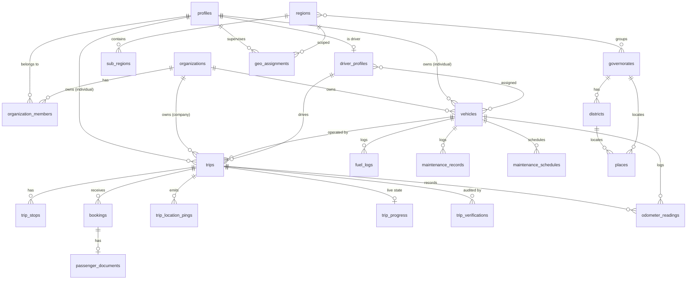

# Maak (معك) — Trip Management SaaS Platform

**Product & Technical Specification — v1.0**
Status: Draft for approval · Owner: Product/Engineering · Last updated: 2026-10-28

---

## 0. TL;DR

Maak is a multi-tenant SaaS for intercity and inter-governorate trip operation in Yemen.
Individuals and companies register, get verified, register vehicles and drivers, publish trips,
and sell seats. Passengers search a public trip marketplace, book with ID details, and follow the
trip live. Platform staff verify accounts/vehicles/trips and supervise governorates, districts,
and custom regions — including by scanning a trip QR code and printing an A4 trip manifest.

**Architecture in one line:** Next.js (web) + Expo (iOS/Android) sharing one `@maak/core` package,
against a **Supabase** backend where **all business rules live exactly once — in Postgres**
(RLS + RPC functions). No separate API server, no duplicated business logic per client.

**Delivery:** 11 phases (0–10), each independently shippable. See `IMPLEMENTATION_PLAN.md`.

---

## 1. Goals & Success Criteria

| # | Goal | Success measure (v1) |
|---|------|----------------------|
| G1 | Operators go from signup → verified → first published trip fast | ≤ 24h median for verification turn-around; ≤ 10 min to publish after approval |
| G2 | Passengers find a suitable trip without asking anyone | ≥ 60% of sessions use ≥ 1 filter; search p95 < 300 ms |
| G3 | Trust: nobody unverified can sell | 0 trips publicly visible from unverified owners (enforced by RLS, tested) |
| G4 | Operational visibility for authorities/supervisors | QR scan → manifest < 3 taps; A4 PDF < 2 s |
| G5 | Cheap to maintain | 1 business-logic implementation per rule; adding a client = 0 rule changes |

### Non-goals for v1 (explicitly deferred)
- Online payments / escrow / payouts (design hooks only — `payment_status` reserved).
- Multi-currency settlement and accounting exports.
- Recurring/scheduled trip series and route templates (backlog).
- Ratings/reviews, chat/messaging (WhatsApp deep links instead).
- Full call-center / booking-by-phone agent console.
- Non-Yemen geography (schema is country-aware, but only Yemen is seeded).

---

## 2. Personas & Roles

| Role key | Who | Primary surface |
|---|---|---|
| `guest` | Anonymous visitor | Public site (search, trip detail) |
| `individual` | Single owner-driver or small operator | Operator console (web/mobile) |
| `org_owner` | Company account owner | Company console + billing later |
| `org_manager` | Company staff managing trips/vehicles/drivers | Company console |
| `driver` | Person who physically drives; often also an employee | Driver mobile app |
| `passenger` | Anyone who booked a seat / whole trip | Passenger app + live tracking |
| `geo_supervisor` | Staff with a region/sub-region scope | Supervisor console (QR, verify) |
| `platform_staff` | Platform operations staff | Ops console (verify, search all, PDF) |
| `platform_admin` | Full control, geography + settings + role grants | Admin console |

A single person can hold several roles simultaneously (e.g. `org_owner` + `driver` + `passenger`).
**Roles are never stored on the user row as a scalar.** They are derived from:
- `profiles.verification_status` (account trust),
- `organization_members.role` (company scope),
- `user_roles` (platform/geo roles),
- presence of `driver_profiles` row (`is_active`).

> Clean-code rule: authorisation is always evaluated through SQL helper functions
> (`app.has_role()`, `app.is_verified_actor()`, `app.in_geo_scope()`), never re-implemented in UI code.

---

## 3. Glossary

- **Actor** — the identity performing an action: an individual profile **or** an organization.
- **Operator** — a verified actor that can own vehicles/trips (individual or company).
- **Place** — any addressable point: governorate, district, city, village, landmark, station, airport, border crossing, market, gathering point.
- **Region / Sub-region** — an *administrative grouping created by the platform admin*, containing any set of governorates and/or districts. Used for supervisor scoping and marketing grouping. (Not an official Yemeni admin level.)
- **Gathering point (نقطة التجمع)** — the exact place where passengers meet before departure.
- **Stop** — an intermediate point between origin and destination, optionally sellable.
- **Manifest** — the A4 PDF with vehicle + driver + passenger details for one trip.
- **Seat hold** — temporary reservation while the operator reviews a booking request.

---

## 4. Domain Model

### 4.1 ERD (core)



### 4.2 Tables (schemas: `public` for domain, `app` for private helpers, `audit` for history)

**Identity & trust**
| Table | Key columns |
|---|---|
| `profiles` | `id (auth.users)`, `full_name`, `phone`, `phone_verified_at`, `nationality`, `dob`, `avatar_path`, `kind (individual)`, `verification_status`, `preferred_language`, `created_at` |
| `organizations` | `id`, `legal_name`, `display_name`, `slug`, `tax_id`, `commercial_reg_no`, `logo_path`, `city_id`, `contact_phone`, `contact_email`, `verification_status`, `created_by` |
| `organization_members` | `org_id`, `user_id`, `role (owner,manager,dispatcher,accountant)`, `status (invited,active,removed)`, invited_by, accepted_at |
| `user_roles` | `user_id`, `role (platform_admin,platform_staff,geo_supervisor)`, `granted_by`, `revoked_at` |
| `verification_requests` | `id`, `subject_type (profile,organization,vehicle,driver,trip)`, `subject_id`, `status`, `submitted_by`, `reviewed_by`, `decision_reason`, `decided_at`, `documents jsonb` |
| `audit_log` | `id`, `actor_id`, `action`, `entity_type`, `entity_id`, `before jsonb`, `after jsonb`, `ip`, `created_at` |

**Geography**
| Table | Key columns |
|---|---|
| `regions` | `id`, `parent_region_id` (nullable), `level (region,sub_region)`, `name_ar`, `name_en`, `slug`, `description`, `is_active`, `sort_order` |
| `governorates` | `id`, `code` (ISO 3166-2:YE-xx), `name_ar`, `name_en`, `centroid (geography)`, `is_active` |
| `districts` | `id`, `governorate_id`, `name_ar`, `name_en`, `code` (OCHA pcode), `geom (geography, MultiPolygon)` |
| `places` | `id`, `governorate_id`, `district_id`, `type (city,town,village,landmark,station,airport,border,market,port,hospital,university,custom_gathering_point)`, `name_ar`, `name_en`, `aliases text[]`, `point geography(Point)`, `is_popular`, `is_verified`, `created_by` |
| `region_governorates` / `region_districts` | `region_id`, `governorate_id` / `district_id` — admin assigns coverage to a region |
| `geo_assignments` | `id`, `user_id`, `scope_type (region,sub_region,governorate,district)`, `scope_id`, `can_view_passengers bool`, `granted_by`, `expires_at` |

**Fleet**
| Table | Key columns |
|---|---|
| `vehicles` | ~60 attribute columns (see §6.3), + `owner_profile_id` XOR `owner_org_id`, `verification_status`, `status`, `current_odometer_km`, `odometer_unit` |
| `vehicle_photos` | `vehicle_id`, `storage_path`, `kind (exterior,interior,document)`, `sort_order` |
| `driver_profiles` | `id`, `user_id`, `org_id?`, `license_no`, `license_class`, `license_expiry`, `dob`, `phone_alt`, `verification_status`, `is_active`, `years_experience` |
| `vehicle_driver_assignments` | `vehicle_id`, `driver_id`, `valid_from`, `valid_to`, `is_default` |
| `odometer_readings` | `id`, `vehicle_id`, `trip_id?`, `kind (baseline,trip_start,trip_end,manual)`, `value_km`, `recorded_at`, `recorded_by`, `photo_path`, `note` |
| `fuel_logs` | `id`, `vehicle_id`, `trip_id?`, `filled_at`, `liters`, `price_minor`, `currency`, `odometer_km`, `station_place_id?`, `full_tank bool`, `receipt_path` |
| `maintenance_records` | `id`, `vehicle_id`, `schedule_id?`, `kind (oil,tyres,brakes,engine,ac,inspection,other)`, `performed_at`, `odometer_km`, `cost_minor`, `vendor`, `description`, `attachments` |
| `maintenance_schedules` | `id`, `vehicle_id`, `kind`, `interval_km`, `interval_days`, `last_done_at`, `last_done_km`, `next_due_km (generated)`, `next_due_at (generated)`, `is_active` |

**Trips**
| Table | Key columns |
|---|---|
| `trips` | `id`, `code` (human ref e.g. `MK-2026-000123`), `title`, `description`, `owner_profile_id` XOR `owner_org_id`, `vehicle_id`, `driver_id`, `pickup_place_id`, `gathering_point_place_id`, `gathering_point_note`, `destination_place_id`, `departure_at timestamptz`, `estimated_arrival_at`, `timezone` (default `Asia/Aden`), `trip_type (one_way,round_trip,charter)`, `seats_total`, `seats_available`, `price_per_seat_minor`, `currency`, `booking_mode (per_seat,whole_trip,both)`, `whole_trip_price_minor`, `discount_kind (none,fixed,percent)`, `discount_value`, `discount_scope (per_seat,whole_trip,all)`, `pricing_mode (flat,per_stop)`, `luggage_policy`, `gender_policy (mixed,families,women_only)`, `cancellation_policy`, `contact_whatsapp`, `status (draft,published,in_progress,completed,cancelled)`, `verification_status (unsubmitted,pending,verified,rejected,revoked)`, `verified_by`, `verified_at`, `qr_token uuid`, `published_at`, `cancelled_reason` |
| `trip_stops` | `id`, `trip_id`, `sort_order`, `place_id`, `label`, `arrival_offset_minutes`, `departure_offset_minutes`, `price_from_origin_minor` (NULL → use trip price), `allows_pickup`, `allows_dropoff`, `note` |
| `bookings` | `id`, `trip_id`, `passenger_user_id`, `seats`, `boarding_stop_id?`, `alighting_stop_id?`, `fare_minor`, `discount_minor`, `total_minor`, `currency`, `status (pending,accepted,rejected,cancelled_by_passenger,cancelled_by_operator,expired,completed,no_show)`, `hold_expires_at`, `passenger_full_name`, `id_type`, `id_number`, `id_place_of_birth`, `mobile`, `note`, `decided_by`, `decided_at`, `decision_reason`, `whatsapp_shared_at`, `checked_in_at`, `created_at` |
| `passenger_documents` | `booking_id`, `storage_path` (private bucket), `mime`, `uploaded_by`, `scan_status` |
| `trip_verifications` | `id`, `trip_id`, `verifier_id`, `decision (verified,rejected,revoked)`, `reason`, `passengers_reviewed int`, `created_at` |
| `trip_location_pings` | `id`, `trip_id`, `driver_id`, `point geography(Point)`, `accuracy_m`, `speed_kmh`, `heading`, `source (device,manual)`, `recorded_at`, `received_at` |
| `trip_progress` | `trip_id PK`, `last_point`, `nearest_stop_id`, `next_stop_id`, `distance_to_next_stop_m`, `eta_next_stop`, `distance_to_destination_m`, `eta_destination`, `remaining_seats`, `updated_at`, `source` |
| `trip_events` | `trip_id`, `kind (created,verified,started,stop_reached,ended,cancelled,driver_changed)`, `payload jsonb`, `at` |
| `saved_searches` / `notification_preferences` / `notifications` | per user (§6.10) |

**Money representation:** `*_minor bigint` + `currency char(3)` (YER exponent = 0).
Never floats. Rounding rule: percent discounts round **half-up to the nearest 1 YER**;
documented in `app.money_round()` and unit-tested.

---

## 5. Permission Model

### 5.1 Trust gates (BR — see §8)

```
unverified actor  → cannot add vehicle · create trip · assign driver · accept/cancel booking
verified actor    → all of the above
verified trip     → only then can driver press "Start trip"
verified vehicle  → cannot be assigned to a published trip
verified driver   → cannot be assigned to a published trip
```

"Verified actor" = `profiles.verification_status = 'verified'` **or** owning org is `verified`
(for company-owned resources). Effective status is computed by `app.actor_verification(profile_id, org_id)`.

### 5.2 Capability matrix

| Capability | Guest | Passenger | Verified individual | Verified company (owner/manager) | Driver | Geo supervisor | Platform staff | Platform admin |
|---|---|---|---|---|---|---|---|---|
| Browse public trips & filters | ✅ | ✅ | ✅ | ✅ | ✅ | ✅ | ✅ | ✅ |
| Book a seat | ❌ | ✅ | ✅ | ✅ | ✅ | ✅ | ✅ | ✅ |
| See own bookings / history | ❌ | ✅ | ✅ | ✅ | ✅ | ✅ | ✅ | ✅ |
| See live progress of a trip | ❌ | booked only | booked only | owner side | driving only | scope only | all | all |
| Register vehicle / driver | ❌ | ❌ | ✅ | ✅ | ❌ | ❌ | ❌ | ✅ |
| Create / edit trip | ❌ | ❌ | ✅ (own) | ✅ (org) | ❌ | ❌ | ❌ | ✅ |
| Assign vehicle/driver | ❌ | ❌ | ✅ (own) | ✅ (org) | ❌ | ❌ | ❌ | ✅ |
| Accept / reject / cancel booking | ❌ | ❌ | ✅ (own trips) | ✅ (org trips) | ❌ | ❌ | ✅ | ✅ |
| Verify accounts / vehicles / drivers | ❌ | ❌ | ❌ | ❌ | ❌ | ❌ | ✅ | ✅ |
| Verify trips (+ passengers), bulk | ❌ | ❌ | ❌ | ❌ | ❌ | ✅ in scope | ✅ | ✅ |
| Search historical/completed trips | ❌ | own only | own only | own only | own only | ✅ in scope | ✅ all | ✅ all |
| Manage geography & regions | ❌ | ❌ | ❌ | ❌ | ❌ | view only | view | ✅ |
| Assign geo supervisors | ❌ | ❌ | ❌ | ❌ | ❌ | ❌ | ❌ | ✅ |
| Print A4 manifest | ❌ | ❌ | own trips | own trips | ❌ | ✅ in scope | ✅ | ✅ |
| Platform settings | ❌ | ❌ | ❌ | ❌ | ❌ | ❌ | read | ✅ |

### 5.3 Enforcement layers (defense in depth)

1. **DB constraints** — invariants that must never be violated (seats ≥ 0, mono-tonic odometer, cutoffs).
2. **RLS policies** — row visibility, all tables, `FORCE ROW LEVEL SECURITY`.
3. **RPC functions** (`SECURITY DEFINER`, `search_path` pinned) — every state transition; UI never writes tables directly except trivial own-profile fields.
4. **Client guards** — UX only (disable buttons, show reasons). Never the security boundary.

---

## 6. Functional Specification

### 6.1 Accounts, onboarding & verification

**Individual account**
- Sign up with phone (OTP) — primary in Yemen — or email+password; OTP via Supabase Auth (SMS provider pluggable, e.g. Twilio/Unifonic/local aggregator).
- Profile: full name, phone, optional national ID, city, avatar.
- Submit verification: full name, ID type (`national_id`, `passport`, `residence`), ID number, ID photo(s), selfie optional.
- Status: `unverified → pending → verified | rejected(reason)`. Rejected can resubmit after edit.

**Company account**
- Created by any verified individual → creator becomes `org_owner`.
- Fields: legal name, display name, slug, commercial registration no., tax ID, logo, address (place), contact phone/email.
- Add staff by phone/email invite → `organization_members` (`manager`, `dispatcher`, `accountant`).
- Company verification: commercial registration document + owner ID; approved by platform staff.

**Platform & geo roles**
- Granted only by `platform_admin` (`user_roles`) — never self-service.
- `geo_supervisor` grant requires at least one `geo_assignments` row.

**Rules**
- One phone = one auth user. A user may belong to many organizations.
- Account switching in UI is context only; permissions always re-evaluated server-side.
- Deleting an account = soft delete + anonymisation job (retain financial/audit records).
- Verification decisions are always audited with actor, reason, timestamp; notifications sent in-app + push.

### 6.2 Geography & places

- **Hierarchy:** `regions` (self-referencing: `region` → `sub_region`) → contains **governorates** → contains **districts**; any set, admin-defined. A region may include whole governorates and/or cherry-picked districts.
- **Seed (Phase 2):** 22 Yemeni governorates (incl. Amanat Al Asimah, Socotra), ~333 districts, + curated `places`:
  cities, airports, ports, border crossings, major hospitals/universities, markets, and famous landmarks
  (e.g. Old Sana'a, Bab al-Yemen, Socotra, Seiyun, Shibam, Al Mukalla corniche, Taiz Castle, Ibb, Zabid, Marib dam).
  Import pipeline: CSV/GeoJSON → validated → idempotent upsert (idempotency key = `code`/`name+gov`).
- **Admin CRUD** for regions/sub-regions/governorates/districts/places; bulk import with dry-run diff preview.
- **Place picker component** (shared across web + mobile):
  - type-ahead over `name_ar`, `name_en`, `aliases` (trigram index), scoped by governorate/district,
  - "popular" quick picks, "use my location" (nearest place),
  - create custom gathering point (verified actors only; `is_verified=false` until staff confirm),
  - optional map pin for exact point.
- **Supervisor scoping:** `geo_assignments` rows (region/sub_region/governorate/district) + `can_view_passengers`.
  A trip is *in scope* if its pickup, gathering point, destination **or any stop** lies in the scope's
  governorates/districts (`app.trip_in_scope(trip_id, user_id)` with a cached `trip_scope_index` table for speed).

### 6.3 Fleet: vehicles & drivers

**Vehicle registration (verified actors only).** Field set — all optional unless marked *required*:
- *Identity:* make*, model*, year*, trim, body type (sedan/SUV/van/minibus/bus/pickup/4x4), generation, plate number*, plate region, VIN/chassis, engine number, vehicle nickname.
- *Mechanical:* drive type (`FWD,RWD,AWD,4WD`), transmission (`manual,automatic,CVT,DCT,AMT`), fuel type (`petrol,diesel,hybrid,plug_in_hybrid,electric,LPG,CNG`), engine size (cc), cylinders, horsepower, fuel tank (L), rated consumption (L/100km), emission standard, start/stop, cruise control.
- *Capacity:* total seats* (incl. driver), passenger seats*, doors, luggage capacity (L), max luggage pieces, roof rack, tow hitch.
- *Comfort:* AC*, climate zones, rear AC vents, heater, audio/USB/Bluetooth/CarPlay, USB port count, wifi hotspot, phone chargers, sunroof, curtains, reclining seats, seat layout notes, screen/TV, fridge/cooler, child seat, booster, prayer mats, tissues/water.
- *Safety & compliance:* first aid kit, fire extinguisher, spare tyre + tools, ABS/airbags note, insurance company/policy/expiry, registration number/expiry, technical inspection expiry, tourism transport permit*, intercity permit, GPS tracker present.
- *Accessibility:* wheelchair accessible, ramp/lift, assistance needed.
- *Appearance:* exterior color (name + hex), interior color, condition (excellent/good/fair), odometer (initial), odometer unit.
- *Media:* exterior photos (min 3), interior photos, documents (private).
- *Operational:* status (`active,maintenance,suspended,retired`), default driver, allowed drivers[] with validity.
- Computed/derived: average fuel consumption (from `fuel_logs`), maintenance due badges, utilisation rate.

**Validation:** year within 1990..current+1; VIN 17 chars if provided; plate uniqueness per country/region
(soft — warn, don't block, since Yemeni plates can repeat); insurance/inspection expiry warnings at
30/14/7/0 days.

**Driver profiles:** linked to an auth user (`user_id`) — the driver logs in on mobile. Company staff add a
driver by phone invite; the invitee gets a driver account bound to that org. Fields: licence no., class,
expiry, DOB, phone alt., years of experience, photo, ID doc, verification status.
`vehicle_driver_assignments` lets one driver serve many vehicles and vice-versa; trip assignment must
respect a valid, non-expired assignment **or** be explicitly overridden by owner/manager (audited).

### 6.4 Trip creation & lifecycle

**Creation (verified actor).** Steps in the UI (wizard, resumable draft):
1. Route: pickup place*, gathering point* (+ note/pin), destination*, trip type.
2. Schedule: date*, time* (Asia/Aden), estimated arrival, timezone locked to Yemen.
3. Stops: optional ordered list (place, arrival offset, dwell, pickup allowed?, dropoff allowed?, note).
4. Capacity & pricing: seats available*, price per seat*, currency (YER default),
   booking mode (`per_seat` / `whole_trip` / `both`) + whole-trip price,
   **stops pricing**: `flat` (one price for all stops) or `per_stop` (each stop carries `price_from_origin`);
   discount: `none | fixed | percent`, value, scope (`per_seat | whole_trip | all`).
5. Vehicle & driver: vehicle* (must be verified + active), driver* (must be verified + assigned to vehicle or overridden with reason).
6. Policies: luggage, gender policy, cancellation policy, contact WhatsApp, terms.
7. Review → submit → `verification_status = pending` (or `verified` immediately if
   `platform_settings.trip_verification_mode = auto_for_verified_actors`).

**Lifecycle**
```
draft ──submit──> pending ──approve──> verified ──publish──> published ──start──> in_progress ──end──> completed
   │                 │                    │                     │                       │
   └──discard──> (deleted)                └──reject──> rejected  └──cancel──> cancelled  └──cancel──> cancelled
```
- `verification_status` and `status` are **separate fields** (a published trip loses `published` if
  verification is revoked).
- Public visibility requires: `status = 'published' AND verification_status = 'verified' AND departure_at > now()`.
- Full/over-booked trips remain visible but marked "مكتمل العدد" until departure (configurable by setting).

**Edit rules (BR-06):**
- Editable fields before the cutoff: price per seat / whole trip / discount, departure date & time,
  stops (if no accepted bookings beyond affected stops), seats (never below accepted seats),
  vehicle/driver (with audit + notification to accepted passengers), descriptive fields.
- **Hard lock: no edits within `trip_edit_lock_hours` (default 2) of `departure_at`.** Enforced by DB trigger
  `app.assert_trip_editable(trip_id)` used by all update RPCs — not just the UI. Changing departure time is
  allowed as long as the **new** time is > now + lock window.
- Every change writes to `audit_log` and `trip_events`; accepted passengers get notified for material changes
  (price ↑, time change, vehicle change, stop removal).
- Cancel trip: owner/staff with reason; refunds are offline in v1; passengers notified immediately.

**Seat accounting:** `seats_available = seats_total − sum(seats of accepted + pending-within-hold bookings)`.
All mutations go through `book_seats()` / `release_seats()` which lock the trip row (`FOR UPDATE`) —
no race conditions, no overbooking.

### 6.5 Public discovery & search

**Public trips page** — mobile-first, SEO-indexed, Arabic RTL first.

Filters (all combinable, cascading):
- Origin / pickup place (autocomplete, governorate → district → city)
- Destination place
- Gathering point
- Departure date (today / tomorrow / date, range) & time-of-day bucket
- Stops: `any | with_stops | without_stops | contains_stop(place)`
- Seats needed (1..N), price range (min/max), currency
- Trip type, booking mode, discount available, gender policy, amenities
  (AC, wifi, wheelchair, extra luggage), vehicle type, company vs individual operator
- Sort: departure soonest, cheapest, shortest duration, best rated-operator (proxy: completion rate)

**Cascading behaviour:** selecting a filter must recompute the *available* options of every other filter
from the current result set, and show counts, e.g. `عدن (34)`. Implemented as one RPC returning
`{ items, facets, total }` — never N+1 client queries.

**Rules (BR-07, BR-08):**
- Only `published + verified + departure_at > now()` appear. Completed/cancelled/in-progress disappear from
  the public list automatically (a trip moves to "live" only for its booked passengers).
- Guests can search/browse; booking requires sign-in.
- Staff can search **all** trips including history and cancelled (`/staff/trips`), filterable by
  verification status, owner, governorate, date range; results can be exported CSV.

**Performance:** `trips_search` denormalised table (or materialized view) with place ids/names,
stop place ids array, price, seats, timestamps; GIN on place arrays + btree on departure/price;
refresh via triggers on relevant columns. Target: 100k trips, p95 < 300 ms.

**Trip detail page:** gallery, route timeline with stops, map preview, price breakdown incl. discount and
per-stop pricing, operator card (verified badge, completed trips count), policies, "Book" CTA,
remaining seats, share link, structured data (JSON-LD) for SEO.

**Preferences / saved searches:** any user can save a filter set with a name and enable alerts →
new matching trips trigger a notification (Phase 9).

### 6.6 Booking & passenger details

**Flow**
1. Passenger picks boarding stop (if `per_stop`) and alighting stop, seats count → live price breakdown.
2. Booking form (required): full name*, ID type* (`national_id,passport,residence,driving_license`),
   ID number*, ID place of birth*, mobile* (prefilled + verified), note, **ID photo upload** (camera or file;
   stored in **private** bucket `passenger-ids`).
3. Optional: "Share ID privately on WhatsApp" → generates a **signed, single-purpose link**
   (`/s/:token`, expires in 72 h, viewable only by the trip owner/manager, watermarked preview) and opens
   `https://wa.me/<owner number>?text=...`. This lets passengers who don't want to upload still complete
   the trust step. Sharing is recorded (`whatsapp_shared_at`).
4. Submit → `pending` with a hold (`booking_hold_minutes`, default 120, capped before departure).
5. Operator (owner/manager/dispatcher) sees a request inbox per trip: accept / reject with reason.
   Accept requires the operator be verified; triggers seat commit + notification (push/WhatsApp/email).
6. Cancellations:
   - Passenger may cancel **only ≥ `passenger_cancel_cutoff_hours` (2) before departure**; after that the
     button is disabled and the API rejects.
   - Operator may cancel anytime (with reason, passenger notified), or mark `no_show` after departure.
7. `completed` set automatically when the trip completes (or by driver manifest check-in).

**Rules:** no seat overbooking; one user may book multiple seats; passenger cannot book own trip;
duplicate active booking for same trip+identity warns then blocks (configurable);
pending holds expire automatically (cron) and free seats.

**Privacy:** ID photos are never public; signed URLs with 5-minute TTL; access limited to booking owner,
trip owner org members with permission, platform staff/geo supervisors with `can_view_passengers`;
every view is audited (`document_access_log`). Retention: purge 90 days after trip completion (setting).

### 6.7 Trip execution, live location & progress

**Driver console (mobile)**
- Shows today's assigned trips. `Start trip` is **disabled unless `verification_status = 'verified'`**
  and the vehicle/driver assignment is valid.
- Start requires: **odometer reading photo + value** (must be ≥ last recorded for that vehicle),
  optional fuel level, optional notes. Server: `start_trip(trip_id, odo_km, photo_path)`.
- While running: automatic location ping every **10 minutes** (`expo-location` background task on mobile;
  web fallback = manual "I'm here" + browser geolocation while tab open), plus pings on stop arrival.
  Offline queue: pings buffered locally with `recorded_at` and flushed when online (server clamps future times).
- Complete requires: **odometer end reading** (≥ start reading), optional fuel log, incident note.
  Server computes distance travelled and upserts vehicle `current_odometer_km`, fuel-consumption stats,
  and maintenance due statuses.
- Buttons: "Reached stop X", "Report delay/incident", "Call dispatcher".

**Live progress (passenger view — booked users only)**
- Big live card: current position on map, `الآن في: <nearest place>`, next stop with **remaining km + ETA**,
  remaining km/ETA to destination, progress bar % of route, last update time + "live/stale" badge.
- Text template the spec asks for:
  > «الآن في **الحوطة** · بعد ١٠ دقائق سيكون في **الصخرة** · يتبقى **٢٤ كم** لأقرب توقف (**توقف الراهدة**) · يتبقى **١٣٧ كم** للوصول إلى **عدن**»
- Updates pushed via Supabase Realtime (private channel `trip:<id>`, RLS-authorised) with 30 s polling fallback.
- Staleness: no ping for > 20 min → "الموقع غير محدّث" + last known point; > 60 min → escalate to ops.
- Visibility: only `accepted` passengers, trip owner/staff, geo supervisors in scope, platform staff.
  Location granularity is the raw ping point (coarse option: snap to nearest place only) — config.

**Progress computation** (`record_trip_ping` → `app.recompute_trip_progress`)
1. Store ping in `trip_location_pings`.
2. Find nearest upcoming stop by route order and geo distance (PostGIS KNN).
3. If a route polyline is available (`trip_route_geometry`, produced by routing provider at publish time),
   compute remaining distance along the line via `ST_LineLocatePoint` + `ST_Length`; else fall back to
   haversine sum over the stop sequence.
4. ETA = remaining distance ÷ rolling average speed (last 30 min) with a floor, else posted schedule.
5. Upsert `trip_progress`; a trigger pushes `trip_events`/Realtime broadcast; update `nearest place` label.

### 6.8 Staff operations (QR, verification, manifest)

**QR scan**
- Every verified trip gets `qr_token` (unguessable uuid) rendered as QR on the operator's trip page.
- Staff/supervisor scans with camera (Web or Expo) → resolves trip → **permission-trimmed view**:
  - basic (any staff): trip summary, route, status, owner, vehicle plate, driver name
  - `can_view_passengers = true`: passenger list (name, seats, boarding stop, ID type masked, mobile masked)
  - `platform_staff/admin`: full passenger details + ID document viewer (audited)
- Scanning is auditing (`audit_log` action `trip.qr_scan`) and works even for historic trips.
- Invalid/expired token → generic error; rate-limited.

**Bulk verification (Phase 7)**
- `bulk_verify_trips(ids[], decision, reason)` — verify/reject many trips.
- `bulk_verify_trips_with_passengers(ids[], decision, reason)` — verify trips **and** their pending passengers.
- `bulk_verify_passengers(trip_id, booking_ids[], decision, reason)` — within a single trip.
- `bulk_verify_entities(type, ids[], decision)` — profiles/orgs/vehicles/drivers (ops console).
- All-or-nothing per row with per-row result report (`{id, ok, error}`); partial success allowed and shown;
  every decision audited and notified. Respect geo scope: rows outside scope are rejected with clear error.

**A4 manifest PDF**
- Route: `GET /api/trips/:id/manifest.pdf` (server-rendered, `@react-pdf/renderer`, Arabic font embedded).
- One A4 page: header (platform, trip code, QR), trip summary (route, stops, times, seats, price),
  vehicle block (make/model/year/trim/plate/color/drive/transmission/fuel/seats/AC/insurance expiry),
  driver block (name, licence, phone), passengers table (#, name, seats, boarding stop, mobile, ID type +
  masked number, status) — compact 2-column layout when > 14 passengers; overflow to a second page only
  if physically required (documented, > 30 passengers).
- Permission: trip owner, geo supervisor in scope, platform staff. Every generation audited.

### 6.9 Vehicle operations (ODO, fuel, maintenance)

- **ODO:** every trip start/end writes `odometer_readings`; vehicle `current_odometer_km` kept in sync by
  trigger with a monotonic check (`new ≥ current`, else rejected with a clear message and manual-override
  flow for owner/manager with reason). Manual readings allowed with photo.
- **Fuel:** log litres, price, station, full-tank flag, ODO → compute consumption between full tanks
  (`L/100km`, `km/L`, cost/km), per-trip fuel cost, monthly trend.
- **Maintenance:** records (what, when, ODO, cost, vendor, attachments) + **schedules**
  (`interval_km`, `interval_days`). `next_due_km/at` are generated columns; a daily cron materialises
  `maintenance_status` and creates reminders at 500 km / 1000 km / 14 days / 7 days / due / overdue.
  Overdue vehicles show a badge and (setting) can block new trip assignment.
- **Dashboards:** per-vehicle health card, fleet rollup (utilisation, km, cost/km, fuel efficiency,
  upcoming maintenance), CSV/PDF export.
- **Auto tracking:** trip start/end ODO is the primary source; the cron fills gaps and flags anomalies
  (e.g. end − start ≠ route distance ± 20%).

### 6.10 Notifications, preferences & history

| Event | Passenger | Operator | Staff |
|---|---|---|---|
| Verification decided | ✅ | ✅ | — |
| Booking requested | — | ✅ | — |
| Booking accepted / rejected | ✅ | — | — |
| Trip changed (price/time/vehicle) | ✅ | — | — |
| Trip cancelled | ✅ | ✅ | ✅ |
| Trip starting in 2 h (reminder) | ✅ | ✅ | — |
| Trip started / ended | ✅ | ✅ | ✅ |
| Delay/incident reported | ✅ | ✅ | — |
| Maintenance due/overdue | — | ✅ | — |
| New trip matching saved search | ✅ | — | — |

Channels: **in-app** (`notifications` table + Realtime), **push** (Expo), **email** (Resend), and
**WhatsApp deep link** (no WhatsApp Business API in v1 to avoid cost; upgrade path documented).
Per-event, per-channel `notification_preferences`; quiet hours 22:00–06:00 (Asia/Aden) except critical
(trip cancellation, verification decision).

**History**
- Passenger: past/upcoming bookings, status, cancel, download receipt-like summary, re-book.
- Operator: trips list (draft/published/completed/cancelled), revenue summary (accepted bookings), per-trip manifest.
- Staff: full-text + filtered search over all trips/bookings with CSV export.
- Nothing is hard-deleted; trips are archived, and public visibility is computed (BR-07).

### 6.11 Admin & settings

`platform_settings` (JSONB, versioned, audited): edit lock hours (2), passenger cancel cutoff (2),
booking hold minutes (120), trip verification mode, ping interval (10 min), stale thresholds,
maintenance reminder thresholds, ID retention days, feature flags (whole-trip booking, gender policy,
saved-search alerts), supported currencies, platform contact info, SMS/push/email provider keys (via env).

Admin console: users/orgs (verify, suspend, grant roles), geography CRUD + import, region coverage,
geo supervisor assignment, settings editor, audit log explorer, health dashboard (pending verifications,
stale live trips, failed notifications, overdue maintenance count).

---

## 7. State Machines

**Trip lifecycle:** `draft → published → in_progress → completed` | `cancelled` (from any non-terminal).
Edits allowed in `draft|published`; start requires `published + verified + now ∈ [departure − window, +2h]`.

**Trip verification:** `unsubmitted → pending → verified | rejected` ; `verified → revoked` (by staff, with reason).
Any material edit by the owner on a verified trip sets `pending` again *if* `reverify_on_edit = true`
(setting, default `true` for company accounts, `false` for individuals with clean history).

**Booking:** `pending → accepted | rejected | expired`; `accepted → cancelled_by_passenger | cancelled_by_operator | completed | no_show`.
Transitions are guarded in RPCs with explicit `app.assert_transition(from, to)`.

**Verification request:** `pending → approved | rejected`; re-submission creates a new request (history kept).

**Vehicle:** `active ↔ maintenance`; `active → suspended → retired`.

---

## 8. Business Rules (single source of truth)

| ID | Rule | Enforced by |
|---|---|---|
| BR-01 | Only verified actors add vehicles/drivers | RLS + `app.is_verified_actor()` |
| BR-02 | Only verified actors create trips | RPC guard |
| BR-03 | Only verified actors assign drivers / accept / cancel bookings | RPC guard |
| BR-04 | Only verified + active vehicles and verified drivers can be attached to a verified/published trip | Trigger |
| BR-05 | Only verified trips can be started; only the assigned driver (or owner override, audited) can start | `start_trip()` |
| BR-06 | No trip edits inside `trip_edit_lock_hours` (2 h) before departure | `app.assert_trip_editable()` trigger |
| BR-07 | Public list = `published` ∧ `verified` ∧ `departure_at > now()` | `trips_search` view + RLS |
| BR-08 | Completed/cancelled/in-progress trips vanish from public search instantly | Derived visibility |
| BR-09 | Passengers cancel only ≥ 2 h before departure | `cancel_booking()` |
| BR-10 | No overbooking; seats reserved transactionally | `book_seats()` `FOR UPDATE` + CHECK |
| BR-11 | Pending bookings expire after hold window | `pg_cron` |
| BR-12 | Booking requires all passenger identity fields + optional ID image | Table constraint + RPC |
| BR-13 | ID documents: private bucket, signed URLs ≤ 5 min, access audited, purge after retention | Storage policy + cron |
| BR-14 | Live location visible only to accepted passengers of that trip + staff/supervisors in scope | Realtime RLS + RPC |
| BR-15 | A ping may not be more than 5 min in the future nor move the trip backwards in route order | `record_trip_ping()` |
| BR-16 | Start/end ODO required and monotonic per vehicle | `start_trip()` / `end_trip()` |
| BR-17 | Geo supervisors only see/verify trips intersecting their scope | `app.trip_in_scope()` in RLS |
| BR-18 | Bulk actions return per-row results and are fully audited | RPC |
| BR-19 | Every verification decision has an actor, reason and timestamp | `audit_log` NOT NULL |
| BR-20 | Money is integer minor units + currency; percent rounding is half-up | DB types + `app.money_round()` |
| BR-21 | Trip owner cannot book own trip; driver cannot book own trip | RPC guard |
| BR-22 | Seats for a trip may never drop below accepted seats | Trigger |
| BR-23 | QR token is unguessable and never exposes passenger data without permission | Signed token + RPC trimming |
| BR-24 | All timestamps stored UTC; displayed in Asia/Aden | Convention + UI formatter |
| BR-25 | Whitelisted/complete-only trip edits: any material change notifies accepted passengers | Trigger → notifications |

---

## 9. Architecture

### 9.1 Stack

| Layer | Choice | Why |
|---|---|---|
| Web | Next.js (App Router) + React + TypeScript (strict) | SEO for public trips, server components, one deploy on Vercel |
| Mobile | Expo (React Native, expo-router) | One codebase for iOS/Android, OTA updates, background location, push |
| Shared | `@maak/core` (types, zod, RPC client, i18n, formatters, state hooks) | One brain for both clients |
| Design | Tailwind + NativeWind with shared design tokens | Consistent UI, one palette/typography source |
| Backend | **Supabase** (Postgres + PostGIS, Auth, RLS, RPC, Storage, Realtime, pg_cron, Edge Functions) | No server to maintain; business logic in DB |
| Maps | MapLibre + OSM tiles; OSRM/OpenRouteService for routes; Nominatim geocode (self-host option) | Free of vendor lock; Yemen coverage OK; no per-map-load cost |
| PDF | `@react-pdf/renderer` in a Next route handler | Server-side A4, no browser dependency |
| Jobs | `pg_cron` + DB functions; Edge Functions only for outbound HTTP (SMS/push/email) | Cheapest, closest to data |
| Testing | pgTAP (RLS/RPC), Vitest (unit), Playwright (web e2e), Maestro (mobile smoke) | Protect the invariants that matter |
| Ops | Sentry, Supabase logs/metrics, GitHub Actions CI, Vercel preview envs | Small-team friendly |

### 9.2 Monorepo layout

```
maak/
├─ apps/
│  ├─ web/                       # Next.js: public site + operator + admin + staff consoles
│  │  └─ src/
│  │     ├─ app/                 # routes only (thin)
│  │     ├─ modules/             # feature modules (see 9.3)
│  │     ├─ components/          # shared UI primitives (web)
│  │     └─ lib/supabase/        # browser/server clients
│  └─ mobile/                    # Expo app (driver-first + passenger)
│     └─ src/
│        ├─ app/                 # expo-router routes
│        ├─ features/            # thin screens over @maak/core
│        └─ lib/                 # location task, push, secure store
├─ packages/
│  ├─ core/                      # ⭐ domain types, zod schemas, RPC client, rules mirrors, i18n
│  ├─ design-tokens/             # colors, spacing, typography (JSON → tailwind + nativewind)
│  └─ config/                    # eslint, tsconfig, prettier presets
├─ supabase/
│  ├─ migrations/                # numbered, forward-only
│  ├─ functions/                 # edge functions (notify, sms, geocode proxy)
│  ├─ seed/                      # geography CSVs, demo data
│  └─ tests/                     # pgTAP
├─ docs/                         # ADRs, runbooks
├─ specs.md
└─ IMPLEMENTATION_PLAN.md
```

### 9.3 Feature-module contract (clean code)

Each domain is a **module with a narrow public surface**:

```
modules/trips/
├─ api.ts            # typed wrappers over RPCs (the only I/O used by UI)
├─ queries.ts        # TanStack Query keys + hooks
├─ components/       # trip-specific UI (web)
├─ schemas.ts        # zod (re-exported from @maak/core)
└─ index.ts          # PUBLIC API — the only file other modules may import
```

Enforced by `eslint-plugin-boundaries` (deep imports fail CI). Cross-cutting concerns (auth, i18n,
notifications, permissions) live in `modules/<x>` and are consumed through their `index.ts`.

### 9.4 Data access strategy — the core cost-saving decision

> **Every mutation is a Postgres function. Every read is a view or function. Clients never assemble business rules.**

```
Web (Next.js) ─┐
               ├─> @maak/core supabase client ─> PostgREST RPC ─> plpgsql (rules, guards, audit)
Mobile (Expo) ─┘                                      │
                                                      └─ RLS (visibility)
```

Consequences:
- Adding a client (e.g. a kiosk app) = **zero** rule rewrites.
- No REST/GraphQL schema to version; RPC signatures **are** the API contract, versioned by migration.
- Bugs are fixed once, at the DB layer, for all platforms.
- The UI carries no trust: guards are server-side, so a hacked client can't bypass cutoffs or verification.

**Guardrails:** every `SECURITY DEFINER` function sets `search_path = ''` + fully-qualified names;
RLS is tested by pgTAP per table; `supabase db lint` + `plpgsql_check` in CI; generated types
(`supabase gen types typescript`) are committed and a CI job fails when out of sync.

### 9.5 Environments

`local` (Supabase CLI, Docker) → `staging` (Supabase project + Vercel preview + Expo dev/EAS internal)
→ `production`. Migrations applied by CI (`supabase db push` with review gate). Seed data is
environment-scoped (`seed/geography` always; `seed/demo` staging only).

---

## 10. Search & Geospatial Design

- `places.point geography(Point,4326)`, GIST index; `districts.geom` for scope checks.
- `trips_search` denormalised row per trip: `trip_id, owner_type, owner_id, origin place ids/names,
  destination place ids/names, stop_place_ids uuid[], has_stops bool, departure_at, duration_minutes,
  price_min_per_seat, seats_available, trip_type, booking_mode, has_discount, gender_policy,
  amenities text[], vehicle_seats, verified_at`.
- Indexes: GIN(`stop_place_ids`), btree(`departure_at`), btree(`price_min_per_seat`),
  GIN trigram on place names for autocomplete, composite(`status`,`verification_status`,`departure_at`).
- `search_public_trips(filters jsonb, sort text, cursor text, limit int)` returns
  `{ items jsonb, facets jsonb, next_cursor, total_estimate }` — keyset pagination (no OFFSET).
- Facet computation: `GROUP BY` over the filtered set excluding the facet's own dimension (classic
  cascading behaviour), capped and cached in a 30 s materialized snapshot table (`search_facets_cache`)
  refreshed by trigger/cron to keep p95 low.
- Route distance/ETA: routing provider at publish (cache by origin/destination/stop hash); fallback to
  haversine × road-factor (1.25) when the provider is unavailable.

---

## 11. Security & Privacy

- **Auth:** Supabase Auth; phone OTP primary; rate-limited; optional TOTP for staff; session refresh via
  SSR cookies (web) and SecureStore (mobile). No service-role key in any client.
- **RLS:** enabled + forced on all tables; `anon` sees only the public search view; no table grants to `anon`
  beyond that. Tests assert every table denies cross-tenant reads.
- **Storage:** `vehicle-photos` (public read, owner write), `verification-docs` (private),
  `passenger-ids` (private), `odometer-photos` (private), `manifests` (private, 24 h TTL links).
  Policies keyed on path prefixes `<owner_type>/<owner_id>/...`.
- **PII:** ID numbers masked in lists (`••••1234`), full value only for staff with permission (audited).
  ID images watermarked with "للاستخدام في رحلة <code>". Retention: purge 90 days post-trip (configurable).
- **Audit:** every verification, document view, manifest generation, QR scan, role grant, settings change,
  and price/date edit is appended to `audit_log` (append-only; no UPDATE/DELETE grants).
- **Abuse:** rate limits on booking creation (5/10 min/user), OTP (3/10 min), QR scans (60/min/user),
  search (120/min/IP). CAPTCHA on signup if needed.
- **Compliance:** data export/delete endpoints per user; privacy notice; audit retention 2 years.

---

## 12. Mobile & Web Strategy

- **Web (Next.js):** public marketplace (SSR/ISR, SEO), operator console, admin/staff console,
  print-friendly manifest. PWA installable with offline shell for the driver screens.
- **Mobile (Expo):** driver-first (start/end trip, ODO capture with camera, background location, push)
  + passenger (search, booking, live tracking, ticket/QR).
- **Sharing:** all types, zod schemas, RPC calls, i18n strings, formatters, permission helpers live in
  `@maak/core`. Screens are thin. Design tokens shared; components are platform-specific but
  visually identical (same tokens, same spacing scale).
- **Offline:** ping queue + "pending sync" badge; ODO photo captured offline and uploaded on reconnect;
  cached trip manifest for drivers (read-only).
- **Background location:** `expo-task-manager` + `expo-location` with 10-min minimum interval;
  Android foreground service notification; iOS "Always" permission with clear in-app explanation
  (App Store requirement). Fallback: manual "checkpoint" button if permission denied.
- **Releases:** EAS build + submit; OTA updates for JS-only changes; native version bumps only when needed.
- **RTL/AR:** Arabic (`ar-YE`) primary, English secondary; locale-aware numbers/dates
  (Arabic-Indic optional), `Intl` formatters, mirrored layouts, mixed-direction-safe components.

---

## 13. Non-functional Requirements

| Area | Target |
|---|---|
| Search latency | p95 < 300 ms @ 100k trips, 50 RPS |
| RPC latency (writes) | p95 < 250 ms |
| Web LCP (4G, mid-range Android) | < 2.5 s on trip detail |
| Availability | 99.5% (Supabase Pro + Vercel) |
| Location freshness | ping every 10 min ± 60 s; progress recompute < 2 s |
| Concurrency | 200 simultaneous live trips; 5k pings/hour without table bloat (partition by month) |
| Accessibility | WCAG AA, keyboard nav, 44 px touch targets, contrast-checked tokens |
| Data retention | pings 90 days (then aggregated), ID docs 90 days post-trip, audits 2 years, soft-deleted users anonymised at 30 days |

---

## 14. Testing Strategy

| Layer | Tool | What is protected |
|---|---|---|
| DB | pgTAP | RLS matrix per role, guard functions, cutoffs (freeze time), seat concurrency, scope filtering |
| Unit | Vitest | pricing/discount math, formatters, zod schemas, progress formatting |
| Web e2e | Playwright | signup→verify (seeded)→create trip→book→accept→start→track→manifest |
| Mobile | Maestro | driver start/end trip with ODO, offline queue, login |
| Contract | generated types + CI drift check | Client/DB never desync |
| Load | k6 script | `search_public_trips` + ping ingest |
| Security | Supabase linter + manual review checklist | RLS gaps, definer functions, storage policies |

CI on every PR: typecheck, lint, unit, `supabase db diff` empty, pgTAP, Playwright smoke, bundle budgets.

---

## 15. Cost & Maintenance Strategy (answering "how do I reduce feature-maintenance cost?")

1. **One implementation per rule (Postgres).** Web + mobile + future clients call the same RPCs.
   No duplicated validation, no drift, no "fixed on web but broken on mobile".
2. **No custom backend service.** Supabase provides auth, storage, realtime, cron, functions.
   Nothing to patch, scale, or deploy separately.
3. **RLS instead of hand-written authorisation code.** Adding a role is a policy change, not a new endpoint.
4. **Config over code.** Timings, thresholds, feature flags live in `platform_settings`; ops changes
   don't require a deploy or an app-store release.
5. **Generated types + single zod source.** Rename a column → CI fails until both clients follow.
6. **Feature modules with enforced boundaries.** Deleting/rewriting a feature touches one folder.
7. **Admin-managed geography.** New places/regions are data, never code releases.
8. **Boring, cheap infrastructure.** OSM/MapLibre/OSRM instead of per-load map billing; Expo OTA instead
   of store releases for JS changes; one web deploy for four consoles.
9. **Thin UI, thick core.** Screens are declarative; shared hooks mean a new screen is ~100 lines.
10. **Test the invariants, not the pixels.** pgTAP for the rules that cost money/trust; a small e2e suite
    for flows. Keeps CI fast and refactors safe.

**Indicative running cost (v1):** Supabase Pro $25 + Vercel Pro $20 + EAS (optional) $99 +
domain/email ~$15 + SMS OTP usage (variable, ~$0.02–0.05/SMS) → **~$60–160/month** before SMS volume.
Everything is single-vendor until scale demands otherwise.

---

## 16. Localisation & UX Guidelines

- Arabic-first, RTL; English switchable. All copy in `@maak/core/i18n` (`ar.json`, `en.json`), no hardcoded strings.
- Yemen defaults: timezone `Asia/Aden`, currency `YER`, week starts Saturday, phone format `+967 7XX XXX XXX`.
- Mobile-first layouts, thumb-reachable primary actions, large tap targets, low-bandwidth friendly
  (image sizes, lazy maps, skeleton screens, retry states).
- Every destructive action requires a confirmation with the *reason* where mandated (cancel, reject, revoke).
- Empty states always suggest the next action; errors are human and actionable (Arabic first).
- Trust is visible: verified badges, "منذ" timestamps, trip code, operator history.

---

## 17. Seed Data Plan

| Dataset | Source / approach | Phase |
|---|---|---|
| 22 governorates | Static curated list (ISO codes) | 2 |
| ~333 districts | OCHA/HDX Yemen admin boundaries or GeoBoundaries (import script, P-codes) | 2 |
| ~200 famous places & POIs | Curated CSV with lat/lng (airports, ports, borders, landmarks, hospitals, universities) | 2 |
| Region groupings (e.g., إقليم المرتفعات، الساحل، الشرق) | Admin-defined defaults, editable | 2 |
| Demo accounts/vehicles/trips | Staging-only seed (5 users, 3 orgs, 12 trips) | 4 |

All seeds are **idempotent** (upsert by code/slug) so environments can be refreshed safely.

---

## 18. Risks & Mitigations

| Risk | Impact | Mitigation |
|---|---|---|
| Live GPS unreliable (permissions, coverage, battery) | Tracking looks broken | 10-min pings + stop checkpoints + manual "I'm here" + staleness badges; never silently lie |
| District/POI data quality | Bad filters, bad scope | Verified flag on places, admin curation + import diff review, user-submitted places pending approval |
| SMS OTP cost/failure in Yemen | Signup blocked | Email fallback + WhatsApp OTP provider pluggable; cost caps |
| User reluctance to upload ID | Booking drop-off | WhatsApp private-share path + "pay on boarding" trust model; clear retention policy |
| Verification becomes a bottleneck | Slow onboarding | Configurable auto-verify for trusted actors, bulk tools, SLA dashboard |
| Map/routing provider gaps in Yemen | Wrong distances/ETA | Polyline cached at publish; haversine fallback; ETA shown as estimate |
| Scope creep in v1 | Never ships | Non-goals list + phased gates; payments/reviews explicitly deferred |
| Supabase vendor lock-in | Strategic | Plain Postgres + PostGIS; all logic in SQL migrations; storage paths standard; exit = managed Postgres |

---

## 19. Assumptions & Open Questions

**Assumptions (changeable without rework):**
- No online payment in v1 (cash on boarding; `payment_status` reserved).
- 2-hour edit/cancel windows are defaults, configurable in settings.
- Trips are one-off (no recurrence) in v1.
- One vehicle + one driver per trip per leg (round trips = two trips or a leg extension).
- Passengers' ID data is required for all bookings (per the brief).
- WhatsApp integration = `wa.me` deep links (no Business API).

**Open questions for the product owner:**
1. Should *individual* accounts auto-verify vehicles after one approved document, or every vehicle needs review?
2. Do you need seat-level selection (specific seat numbers) or just seat count?
3. Female/family-only sections — is this required in v1?
4. Should pending bookings auto-expire (e.g., 2 h) or wait until the operator decides?
5. Any commission model to record (even without online payment)?
6. Which SMS/OTP provider is preferred in Yemen?

---

## 20. Requirement Traceability

| Req ID | Requirement (from brief) | Spec section | Phase |
|---|---|---|---|
| R01 | Individual + company accounts | §6.1 | 1 |
| R02 | Both have drivers, vehicles, staff | §6.1, §6.3 | 1, 3 |
| R03 | Create trips → public trips page | §6.4, §6.5 | 4 |
| R04 | Search filters + per-user preferences | §6.5, §6.10 | 4, 9 |
| R05 | Staff verify users, companies, vehicles | §6.1, §6.3, §6.8 | 1, 3, 7 |
| R06 | Verified-only actions (vehicles/trips/drivers/bookings) | §5, §8 BR-01..03 | 1→4 |
| R07 | Full vehicle feature set | §6.3 | 3 |
| R08 | Places: regions, sub-regions, govs, districts, famous places; admin-managed; assignment | §6.2 | 2 |
| R09 | Assign supervisors to regions/sub-regions | §6.2, §6.11 | 2 |
| R10 | QR scan → permission-based trip + passengers | §6.8 | 7 |
| R11 | Trip creation fields, whole-trip booking, discounts, vehicle + driver | §6.4 | 4 |
| R12 | Flat or per-stop pricing | §6.4 | 4 |
| R13 | Edit price/time, locked 2 h before start | §6.4, BR-06 | 4 |
| R14 | Owner/staff accept/cancel bookings | §6.6 | 5 |
| R15 | Passenger cancel ≥ 2 h before | §6.6, BR-09 | 5 |
| R16 | Passenger details + ID photo + WhatsApp share | §6.6 | 5 |
| R17 | Booked-only live status, seats, 10-min location, progress messages | §6.7 | 6 |
| R18 | Bulk verify trips / trips+passengers / passengers | §6.8 | 7 |
| R19 | Driver starts only when trip verified | §6.7, BR-05 | 6 |
| R20 | A4 PDF manifest with vehicle + passengers | §6.8 | 7 |
| R21 | Public guest search, cascading filters, active-only, staff history search | §6.5, BR-07/08 | 4, 7 |
| R22 | Trip history per user | §6.10 | 4, 5 |
| R23 | ODO tracking, fuel, maintenance, auto schedules | §6.9 | 8 |
| R24 | ODO entry on start and completion | §6.7, §6.9 | 6 |

---

## 21. ADRs (decisions, one line each)

- **ADR-01** Business logic in Postgres (RLS + RPC), no custom API server — cheapest to maintain, one rule set for all clients.
- **ADR-02** Next.js for web (SEO-critical marketplace) + Expo for native; share `@maak/core`, not full UI.
- **ADR-03** PostGIS for places/progress; MapLibre + OSM + OSRM (no per-load map billing, no vendor lock).
- **ADR-04** Integer minor units for money; percent rounding half-up, unit-tested.
- **ADR-05** Status and verification are separate fields on trips (revocation without losing lifecycle).
- **ADR-06** Config-driven policy (`platform_settings`) instead of hardcoded thresholds.
- **ADR-07** Private buckets + signed URLs + audited document access; data minimisation with retention windows.
- **ADR-08** Keyset pagination + denormalised `trips_search` + facet cache for cascading filters.
- **ADR-09** One PR per phase with migrations, tests, and demo screenshots; phase gate checklist.
- **ADR-10** Arabic-first RTL with `next-intl`/`i18next` keys in the shared package.
